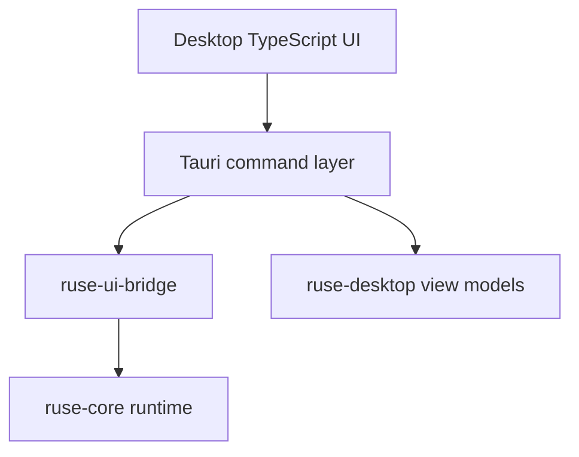

# M21 Desktop GUI MVP Spec

## Purpose

Turn the existing Desktop presentation contracts into a runnable Desktop application that shares the same runtime truth as CLI and TUI. M21 delivers a Tauri-based local app for conversations, tasks, approvals, diffs, trace inspection, and settings.

## Product Context

M10 created Desktop view-model contracts, but no runnable GUI exists. The product goal requires a Codex Desktop-like form for users who prefer visual task management, permission dialogs, and richer inspection surfaces.

## Scope

This milestone delivers:

- runnable Tauri 2 Desktop shell
- Rust command layer that talks to `ruse-ui-bridge`
- TypeScript UI for conversations, prompt composer, task list, approvals, diff review, trace timeline, and settings
- local runtime process or embedded runtime session model
- Desktop-safe config and provider diagnostics
- app-level error, loading, disconnected, and recovery states

Owned by later milestones:

- plugin marketplace UX
- auto-update production release channels
- advanced workspace/project onboarding

## Architecture

Tauri hosts the Desktop UI. Rust-side Desktop commands call shared runtime services and emit UI bridge frames to the frontend. The frontend renders state but does not call model providers, tools, storage, or secrets directly.

## Key Contracts

- `DesktopRuntimeSession`
- `DesktopBridgeCommand`
- `DesktopBridgeEvent`
- `DesktopConversationView`
- `DesktopApprovalView`
- `DesktopDiffView`
- `DesktopTraceView`
- `DesktopSettingsView`

Contract rules:

- frontend state is derived from UI bridge frames and Desktop view models
- settings mutations go through typed commands and config validation
- approvals use the same request ids and lease rules as CLI/TUI
- sensitive values are never serialized to the frontend

## State and Failure Handling

- runtime startup failure shows setup diagnostics
- disconnected bridge enters reconnectable state
- failed commands return typed UI errors
- pending approvals remain visible after app restart when stored
- settings changes validate before persisting

## Security and Privacy

- Desktop never stores raw API keys in app config
- Tauri commands expose a narrow allowlist
- filesystem dialogs do not broaden workspace policy automatically
- traces and logs use redacted event payloads

## Testing Strategy

- Rust command tests for bridge requests and settings validation
- frontend component tests for core views
- Playwright smoke tests for app startup and primary flows
- snapshot tests for permission and diff views
- packaging smoke test for development bundle

## Acceptance Criteria

- A user can launch the Desktop app and start or inspect a conversation.
- Approval and diff workflows use the same runtime events as CLI/TUI.
- Settings can view and validate model/provider config without exposing secrets.
- Desktop startup and bridge errors are visible and recoverable.

## Completion Signal

M21 is complete when a local Desktop build runs against the shared runtime and primary UI smoke tests pass.
