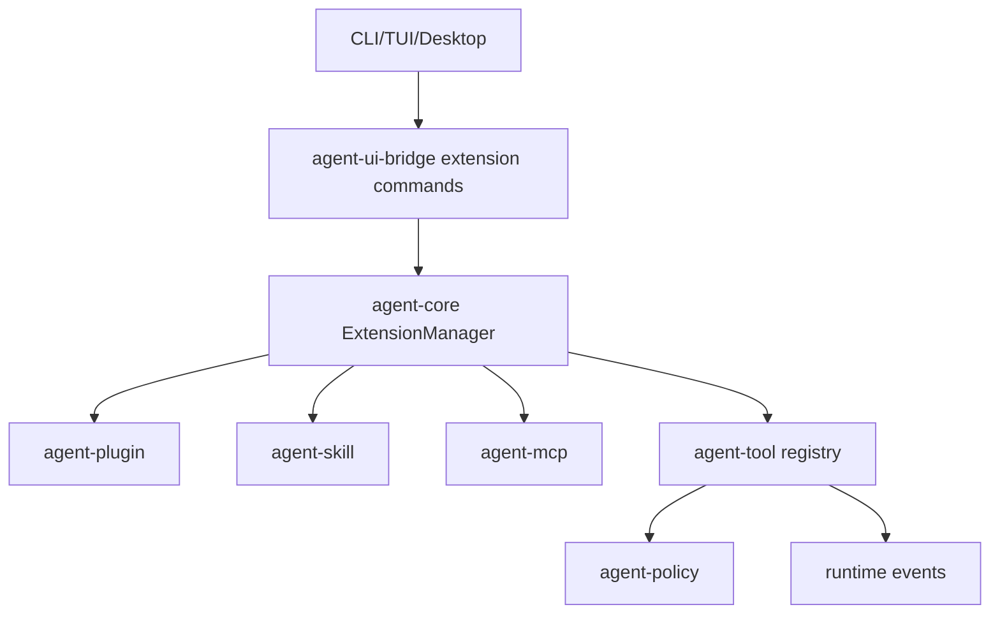

# M22-00 Extension UX and MCP Gateway Technical Design Spec

## Purpose

Define the architecture for extension management and a mature MCP gateway before M22 implementation begins. M22 makes plugins, skills, and MCP servers installable, inspectable, permissioned, health-checked, and executable through the same local tool policy path as built-ins.

## Product Context

M07 introduced MCP and skill contracts. M11 introduced plugin manifests, process hosts, capabilities, hooks, and a WASM prototype. Product users need commands and UI surfaces to manage extensions safely, understand requested capabilities, and run MCP/plugin tools without bypassing policy.

## Scope

This design governs:

- extension registry and installed-state model
- plugin install/list/enable/disable/remove/inspect commands
- skill root management and diagnostics
- MCP server lifecycle and gateway tool registration
- capability review and permission mapping
- extension health reporting
- crash, timeout, and removal behavior

Owned by implementation slices:

- `M22-01-extension-registry`
- `M22-02-plugin-install-commands`
- `M22-03-skill-root-management`
- `M22-04-mcp-gateway-tools`
- `M22-05-extension-health-ui`

## Architecture

`agent-core` coordinates extension lifecycle through domain crates. `agent-plugin` owns plugin manifests and process/WASM host contracts. `agent-skill` owns skill discovery. `agent-mcp` owns MCP client/gateway behavior. Registered extension tools become normal `agent-tool` entries and always route through `agent-policy`.



Dependency rules:

- extension manifests declare capabilities but do not grant them
- MCP tools never bypass local policy
- plugin process output is untrusted
- extension UI receives health and capability summaries, not raw secrets

## Extension Registry

The registry tracks:

- extension id and kind: plugin, skill root, MCP server
- source path or server config source
- manifest or config hash
- enabled state by user/workspace
- declared capabilities
- granted capability leases
- health status
- installed version and compatibility result

Registry state is persisted through configuration/storage contracts. Removing an extension disables its tools and revokes active extension-scoped leases.

## Plugin Management

Plugin install validates:

1. package path or local directory exists
2. manifest schema and api version are supported
3. entrypoint is valid for isolation mode
4. declared tools and hooks have matching capabilities
5. compatibility is accepted
6. capability review is recorded before enablement

Enabled process plugins run with scoped environment and timeout limits. Crashes produce health diagnostics and do not crash the runtime.

## Skill Management

Skill roots are configured per user/workspace. Discovery records source path, skill id, metadata, instruction source hash, and prompt contribution visibility. Skill diagnostics include missing files, duplicate ids, invalid metadata, and unsupported schema versions.

Skills contribute prompt layers through M16 contracts; they do not mutate prompt state directly.

## MCP Gateway

MCP server configs support stdio and HTTP transports according to existing contracts. The gateway:

- initializes enabled servers
- discovers tools/resources/prompts
- maps remote tools into local `ToolDefinition`s
- attaches server id and remote tool metadata
- converts remote calls into local policy requests
- emits trace events for discovery, health, calls, and failures

Unhealthy servers do not register executable tools. MCP responses are untrusted tool output and are subject to observation compression in M18.

## UI and CLI Surface

Initial commands:

- `agent extension list`
- `agent extension inspect <id>`
- `agent plugin install <path>`
- `agent plugin enable|disable|remove <id>`
- `agent skill roots list|add|remove`
- `agent mcp list|add|enable|disable|health`

TUI and Desktop consume extension registry snapshots and health frames from `agent-ui-bridge`.

## Security and Privacy

Extensions are untrusted by default. Capability review must happen before enablement. Secrets are injected only through approved execution contexts. Extension logs are redacted and size-limited. Plugin and MCP tool calls use normal tool audit records with extension source metadata.

## Testing Strategy

Required coverage:

- extension registry state tests
- fixture plugin install and compatibility tests
- plugin enable/disable/remove tests
- skill root diagnostics tests
- MCP gateway fixture server tests
- capability review denial tests
- process plugin crash/timeout tests
- UI bridge extension health snapshot tests

Workspace gates use:

```bash
cargo xtask check
```

## Acceptance Criteria

- Users can install and enable a local process plugin.
- Users can configure an MCP server and run its tools through local policy.
- Skills contribute prompt layers through M16 source metadata.
- Extension health and capability requests are inspectable and UI-safe.

## Completion Signal

M22 technical design is complete when this document and its plan exist, M22 milestone planning marks the design slice complete, and M22-01 can start without unresolved extension registry or MCP gateway decisions.
