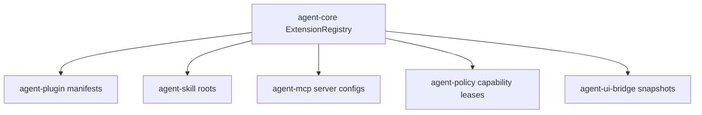

# M22-01 Extension Registry Spec

## Purpose

Create the typed registry model that tracks installed extensions, enablement state, declared capabilities, granted leases, compatibility, and health. This is the foundation for plugin install commands, skill roots, MCP gateway registration, and UI health views.

## Product Context

M22 turns plugin, skill, and MCP contracts into user-manageable extensions. Users need one canonical inventory before install, enable, disable, remove, inspect, and health workflows can behave consistently across CLI, TUI, and Desktop.

## Scope

This spec delivers:

- extension id, kind, source, version, compatibility, capability, lease, enablement, and health contracts
- deterministic `ExtensionRegistry` add/update/remove/query behavior
- registry snapshots that are safe for CLI, TUI, Desktop, and JSON output
- validation for duplicate ids, invalid sources, unsupported compatibility, and unsafe capability summaries
- trace-safe status summaries for later UI bridge events

Owned by other specs:

- plugin filesystem install/copy commands: M22-02
- skill discovery from configured roots: M22-03
- MCP tool execution gateway: M22-04
- UI rendering of health snapshots: M22-05
- durable platform paths and settings migration: M25

## Architecture

`agent-core` owns the coordinating registry because it needs to reason across plugin, skill, and MCP extension kinds without making domain crates depend on each other. Domain crates still own their native manifests and discovery logic. `agent-ui-bridge` receives serializable registry snapshots in M22-05.



## File Layout

```text
crates/agent-core/src/
  extension.rs
  lib.rs
crates/agent-core/tests/
  extension_registry.rs
```

## Public Contracts

```rust
pub struct ExtensionRegistry {
    pub fn new(records: Vec<ExtensionRecord>) -> Result<Self, ExtensionRegistryError>;
    pub fn upsert(&mut self, record: ExtensionRecord) -> Result<(), ExtensionRegistryError>;
    pub fn disable(&mut self, id: &ExtensionId) -> Result<ExtensionRecord, ExtensionRegistryError>;
    pub fn remove(&mut self, id: &ExtensionId) -> Result<ExtensionRecord, ExtensionRegistryError>;
    pub fn snapshot(&self) -> ExtensionRegistrySnapshot;
}

pub struct ExtensionRecord {
    pub id: ExtensionId,
    pub kind: ExtensionKind,
    pub source: ExtensionSource,
    pub enabled: bool,
    pub version: Option<String>,
    pub compatibility: ExtensionCompatibility,
    pub declared_capabilities: Vec<ExtensionCapabilitySummary>,
    pub granted_leases: Vec<ExtensionCapabilityLease>,
    pub health: ExtensionHealth,
}

pub enum ExtensionKind {
    Plugin,
    SkillRoot,
    McpServer,
}
```

All durable or bridge-facing contracts derive `Clone`, `Debug`, `Eq`, `PartialEq`, `Serialize`, and `Deserialize`.

## State and Failure Handling

- duplicate extension ids are rejected on registry construction
- `upsert` replaces an existing record with the same id while preserving deterministic ordering
- `disable` sets `enabled=false`, revokes active leases, and preserves inspection metadata
- `remove` deletes the record and returns the removed state for audit emission
- unsupported compatibility marks a record disabled and unhealthy instead of silently enabling it
- invalid capability summaries return validation errors before registry mutation

## Security and Privacy

- manifests declare capabilities but do not grant them
- leases are explicit records tied to an extension id and expire or revoke on disable/remove
- source paths are normalized for display and must not include raw secrets
- health messages and capability summaries are redacted before serialization
- registry snapshots never include plugin process environment values or MCP secret refs

## Testing Strategy

- unit tests for id validation, duplicate rejection, deterministic ordering, upsert, disable, remove, and lease revocation
- serialization snapshot tests for registry records and UI-safe snapshots
- redaction tests for source and health messages
- compatibility tests for supported, unsupported, and unknown extension versions

## Acceptance Criteria

- `agent-core` exposes `ExtensionRegistry` and registry snapshot contracts.
- Plugin, skill root, and MCP server records can coexist in deterministic order.
- Disabling or removing an extension revokes its active leases.
- Registry snapshots are serializable and secret-safe.
- Focused tests pass with `cargo test -p agent-core extension_registry`.

## Completion Signal

M22-01 is complete when registry contracts and tests pass, public exports are available from `agent-core`, and M22 planning marks the slice complete.
