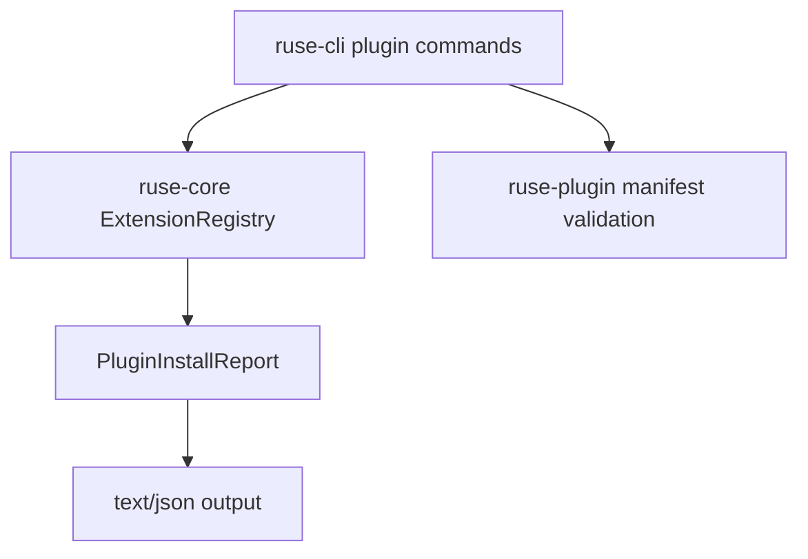

# M22-02 Plugin Install Commands Spec

## Purpose

Add user-facing plugin management commands backed by the extension registry. Users can inspect, install, enable, disable, remove, and list local process plugins without granting capabilities implicitly.

## Product Context

M11 defined plugin manifests, capabilities, process hosts, and WASM prototypes. M22 needs a practical local UX for plugins before MCP gateway and extension health views can feel product-ready.

## Scope

This spec delivers:

- CLI command contracts for `agent plugin install|list|inspect|enable|disable|remove`
- plugin manifest validation and compatibility reporting during install
- local fixture plugin install tests
- capability review records before enablement
- registry integration for installed plugin state
- safe install reports for text and JSON modes

Owned by other specs:

- registry contracts: M22-01
- UI bridge health surfaces: M22-05
- signed marketplace distribution: future milestone
- durable platform plugin paths and update channels: M25

## Architecture

`ruse-cli` owns command parsing and rendering. `ruse-plugin` owns manifest parsing, validation, compatibility, and process plugin contracts. `ruse-core` owns registry mutation. CLI commands call core/domain APIs and do not run plugin tools during install.



## File Layout

```text
crates/ruse-cli/src/
  command.rs
crates/ruse-cli/tests/
  plugin_commands.rs
crates/ruse-plugin/tests/fixtures/
  hello-process-plugin/
    plugin.json
    plugin.sh
```

## Public Contracts

```rust
pub struct PluginInstallRequest {
    pub path: PathBuf,
    pub enable: bool,
    pub accept_capabilities: bool,
}

pub struct PluginInstallReport {
    pub extension_id: String,
    pub manifest_name: String,
    pub version: String,
    pub enabled: bool,
    pub compatibility: String,
    pub capability_review_required: bool,
    pub diagnostics: Vec<PluginInstallDiagnostic>,
}
```

CLI surface:

```text
agent plugin install <path> [--enable] [--accept-capabilities] [--json]
agent plugin list [--json]
agent plugin inspect <id> [--json]
agent plugin enable <id> [--accept-capabilities]
agent plugin disable <id>
agent plugin remove <id>
```

## State and Failure Handling

- invalid path fails before registry mutation
- invalid manifest returns a safe diagnostic with path and schema reason
- unsupported compatibility installs as disabled only when inspectable metadata can be retained
- enable without accepted capability review returns a recoverable error
- disable and remove are idempotent only when the id exists; missing ids produce clear diagnostics
- process host crashes are not exercised by install, only by later execution paths

## Security and Privacy

- install never grants capabilities by manifest declaration alone
- install reports include capability names and resource/action summaries, not secrets
- plugin entrypoint paths are normalized and displayed safely
- JSON output never includes plugin environment variable values
- raw plugin stdout/stderr is not trusted or rendered during install

## Testing Strategy

- CLI parser tests for all plugin subcommands
- fixture install tests for valid, invalid, duplicate, unsupported, enable-without-review, and remove flows
- JSON output tests for stable, redacted install/list/inspect shapes
- registry mutation tests proving enable/disable/remove state transitions

## Acceptance Criteria

- Users can install and inspect a local process plugin fixture.
- Enabling requires explicit capability acceptance.
- Plugin list and inspect work in text and JSON modes.
- Invalid manifests fail safely without registry mutation.
- Focused tests pass with `cargo test -p ruse-cli plugin_commands`.

## Completion Signal

M22-02 is complete when plugin CLI commands operate on the extension registry, fixture tests pass, and capability review is enforced before enablement.
