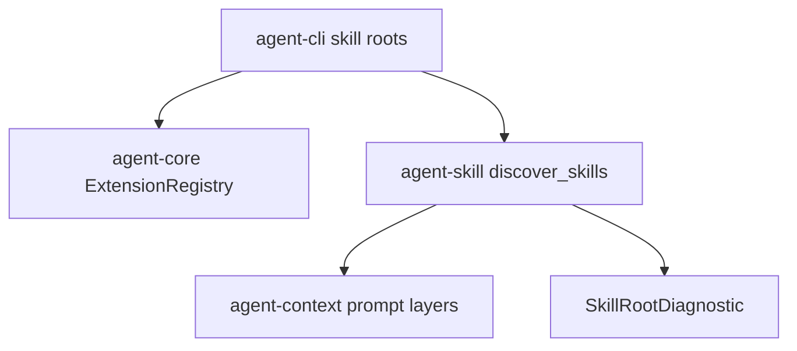

# M22-03 Skill Root Management Spec

## Purpose

Make skill roots manageable as first-class extensions. Users can list, add, remove, enable, disable, and diagnose skill roots while skill prompt contributions continue to flow through M16 prompt layering.

## Product Context

M07 introduced skill discovery and prompt contribution contracts. M22 turns that into an inspectable UX so users can understand which skill roots are active, what skills were discovered, and why a root is unhealthy.

## Scope

This spec delivers:

- `agent skill roots list|add|remove|enable|disable|inspect` command contracts
- skill root registry records using M22-01 extension registry state
- diagnostics for missing roots, missing `SKILL.md`, duplicate skill ids, invalid metadata, and empty prompt bodies
- deterministic skill discovery summaries with source hashes
- prompt contribution traceability back to root and skill id

Owned by other specs:

- extension registry mechanics: M22-01
- Desktop/TUI health rendering: M22-05
- durable settings paths and migration: M25
- skill marketplace or remote skill install: future milestone

## Architecture

`agent-skill` owns discovery, manifests, prompt contribution conversion, and diagnostics. `agent-core` records root enablement through `ExtensionRegistry`. `agent-cli` owns command UX and output rendering. Prompt assembly remains owned by `agent-context`.



## File Layout

```text
crates/agent-skill/src/
  roots.rs
  lib.rs
crates/agent-skill/tests/
  skill_roots.rs
crates/agent-cli/tests/
  skill_root_commands.rs
```

## Public Contracts

```rust
pub struct ManagedSkillRoot {
    pub root_id: String,
    pub path: PathBuf,
    pub enabled: bool,
    pub source_hash: Option<String>,
}

pub struct SkillRootInspection {
    pub root: ManagedSkillRoot,
    pub discovered: Vec<DiscoveredSkillSummary>,
    pub diagnostics: Vec<SkillRootDiagnostic>,
}

pub struct SkillRootDiagnostic {
    pub severity: String,
    pub code: String,
    pub message: String,
    pub skill_id: Option<String>,
}
```

CLI surface:

```text
agent skill roots list [--json]
agent skill roots add <path> [--enable]
agent skill roots inspect <id> [--json]
agent skill roots enable <id>
agent skill roots disable <id>
agent skill roots remove <id>
```

## State and Failure Handling

- adding a missing path records a disabled root with an error diagnostic only when `--allow-missing` is explicitly introduced later; M22 rejects it
- disabled roots remain listed but do not contribute prompt layers
- duplicate root paths are rejected
- duplicate skill ids across enabled roots produce diagnostics and deterministic winner selection only if policy allows; M22 defaults to error
- invalid skill files never produce prompt layers

## Security and Privacy

- skill prompt bodies may influence prompts but are not printed in full by default
- inspection shows metadata, source hashes, and short previews only when not secret-like
- skill roots cannot request tool permissions directly
- skill diagnostics redact token/password/api-key-like content

## Testing Strategy

- `agent-skill` tests for root add/list/disable/remove models and discovery diagnostics
- CLI tests for root commands in text and JSON modes
- prompt contribution tests proving disabled or invalid roots do not reach prompt layers
- redaction tests for diagnostics and previews

## Acceptance Criteria

- Users can manage local skill roots from CLI.
- Enabled valid roots produce discoverable skill summaries.
- Invalid roots produce clear diagnostics without prompt contribution.
- Skill source metadata remains traceable to M16 prompt layers.
- Focused tests pass with `cargo test -p agent-skill skill_roots` and `cargo test -p agent-cli skill_root_commands`.

## Completion Signal

M22-03 is complete when skill roots are registry-backed, command-managed, diagnostic-rich, and safe to feed into prompt assembly.
