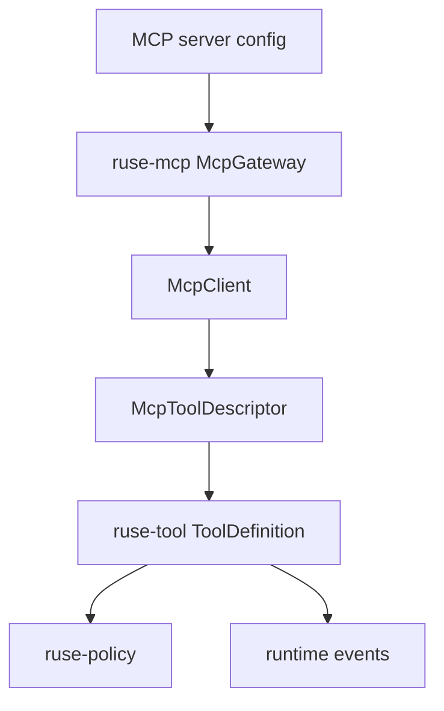

# M22-04 MCP Gateway Tools Spec

## Purpose

Expose MCP server tools as local `ruse-tool` entries that always route through local policy, audit, idempotency, and observation compression. MCP becomes a mature gateway rather than a side channel.

## Product Context

M07 introduced MCP client and policy mapping contracts. M22 needs gateway behavior so configured MCP tools can participate in real comprehensive turns without bypassing the runtime safety model.

## Scope

This spec delivers:

- `McpGateway` contract for enabled server initialization, discovery, registration, execution, health, and shutdown
- conversion of remote MCP tools into local tool definitions with source metadata
- local policy requests for every remote tool call
- fixture MCP server/client tests for healthy, unhealthy, timeout, and denied execution paths
- audit and trace metadata for discovery and calls

Owned by other specs:

- MCP server registry records: M22-01
- MCP CLI config commands beyond gateway execution: M22-05 or M25 depending durability
- UI health rendering: M22-05
- background MCP usage policies: M24

## Architecture

`ruse-mcp` owns gateway contracts and remote protocol adaptation. `ruse-tool` owns the local tool registry abstraction. `ruse-policy` owns permission requests and decisions. `ruse-core` wires gateway-registered tools into comprehensive turn resources.



## File Layout

```text
crates/ruse-mcp/src/
  gateway.rs
  lib.rs
crates/ruse-mcp/tests/
  mcp_gateway.rs
crates/ruse-core/tests/
  mcp_gateway_tool_loop.rs
```

## Public Contracts

```rust
#[async_trait]
pub trait McpGatewayClient: Send + Sync {
    async fn initialize(&self, config: &McpServerConfig) -> Result<McpInitializeResult, McpError>;
    async fn list_tools(&self, server_id: &McpServerId) -> Result<Vec<McpToolDescriptor>, McpError>;
    async fn call_tool(&self, request: McpToolCallRequest) -> Result<McpToolCallResult, McpError>;
}

pub struct McpGateway {
    pub async fn discover_tools(&self, configs: &[McpServerConfig]) -> McpGatewayReport;
    pub fn register_tools(&self, registry: &mut ToolRegistry, report: &McpGatewayReport) -> Result<(), McpError>;
}

pub struct McpToolCallRequest {
    pub server_id: McpServerId,
    pub remote_tool_name: String,
    pub input_json: serde_json::Value,
}
```

## State and Failure Handling

- disabled servers are reported but not initialized
- unhealthy servers do not register executable tools
- remote tool name collisions are avoided through `mcp.<server>.<tool>` local names
- gateway call failures return recoverable tool errors unless policy marks them terminal
- remote responses are bounded and converted to normal tool observations
- timeout and cancellation leave gateway state inspectable

## Security and Privacy

- MCP servers are untrusted
- every remote tool call maps to a local permission request
- server env values use secret refs and are never serialized raw
- remote output is treated as untrusted tool output and subject to M18 observation limits
- trace summaries redact input fields named token, password, secret, api_key, or starting with `sk-`

## Testing Strategy

- gateway discovery tests for enabled, disabled, healthy, unhealthy, duplicate, and timeout servers
- local tool registration tests proving source metadata is attached
- policy denial tests proving denied MCP calls do not reach the client
- core integration test proving a comprehensive turn can call an MCP-backed tool through the normal tool loop
- redaction tests for input and output summaries

## Acceptance Criteria

- Enabled healthy MCP tools appear in the local tool registry.
- Denied MCP calls do not execute remotely.
- Allowed MCP calls emit normal tool results and audit metadata.
- Unhealthy MCP servers are visible but not executable.
- Focused tests pass with `cargo test -p ruse-mcp mcp_gateway` and `cargo test -p ruse-core mcp_gateway_tool_loop`.

## Completion Signal

M22-04 is complete when MCP gateway tools execute only through local policy/tool infrastructure and fixture integration tests prove discovery, denial, execution, and failure behavior.
