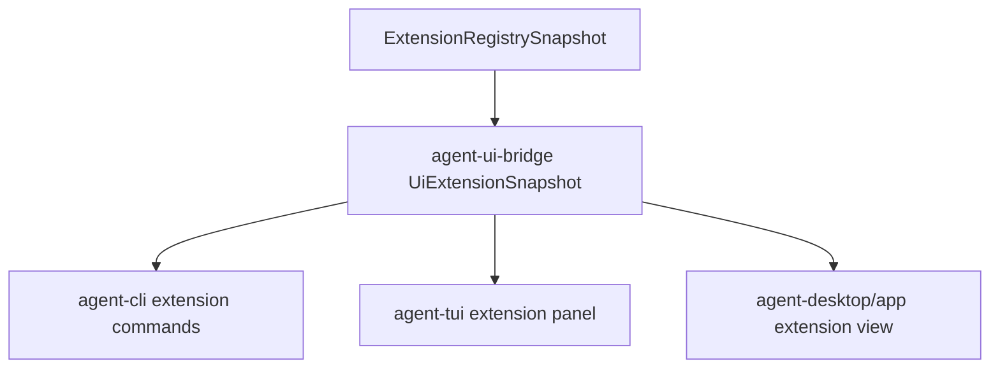

# M22-05 Extension Health UI Spec

## Purpose

Expose extension registry, capability review, and health state through UI-safe contracts for CLI, TUI, and Desktop. Users should be able to see what is installed, enabled, unhealthy, and awaiting review.

## Product Context

M22-01 through M22-04 create the extension state and execution path. M22-05 makes that state visible in user surfaces so extension failures are diagnosable and capability requests are auditable.

## Scope

This spec delivers:

- UI bridge contracts for extension snapshots, health diagnostics, and capability review summaries
- CLI commands for `agent extension list|inspect|health`
- TUI extension summary panel data model
- Desktop extension/settings summary data model without durable mutation
- redacted health logs and bounded diagnostics
- final M22 smoke tests across plugin, skill root, MCP, and health surfaces

Owned by other specs:

- registry state: M22-01
- plugin commands: M22-02
- skill root commands: M22-03
- MCP gateway execution: M22-04
- full Desktop settings editor and persistent config mutation: M25

## Architecture

`agent-ui-bridge` owns serializable UI-safe extension frames. `agent-cli` renders text/JSON commands. `agent-tui` consumes bridge snapshots for a compact panel. `agent-desktop` owns Desktop view models, while `apps/desktop` renders them.



## File Layout

```text
crates/agent-ui-bridge/src/
  frame.rs
  event.rs
crates/agent-cli/tests/
  extension_health_commands.rs
crates/agent-tui/src/
  extension_panel.rs
crates/agent-desktop/src/
  extension.rs
apps/desktop/src/
  components/ExtensionHealthView.tsx
```

## Public Contracts

```rust
pub struct UiExtensionSnapshot {
    pub extensions: Vec<UiExtensionSummary>,
    pub capability_reviews: Vec<UiExtensionCapabilityReview>,
    pub diagnostics: Vec<UiExtensionDiagnostic>,
}

pub struct UiExtensionSummary {
    pub id: String,
    pub kind: String,
    pub enabled: bool,
    pub health: String,
    pub version: Option<String>,
    pub source_label: String,
    pub capability_count: u32,
}

pub enum UiJsonFrame {
    ExtensionSnapshot(UiExtensionSnapshot),
}
```

CLI surface:

```text
agent extension list [--json]
agent extension inspect <id> [--json]
agent extension health [--json]
```

## State and Failure Handling

- missing extension ids return recoverable command diagnostics
- unhealthy extensions remain inspectable
- capability review entries are stable until accepted, denied, or extension removal revokes them
- UI snapshots are derived from registry state and do not mutate extensions
- large logs are truncated with `truncated=true`

## Security and Privacy

- UI snapshots never include raw secret refs, process env, MCP headers, or full skill prompt bodies
- health messages are redacted and size-limited
- capability review summaries show resource/action and reason, not secret payloads
- UI clients cannot grant capabilities except through typed approval/capability commands

## Testing Strategy

- `agent-ui-bridge` serialization tests for extension snapshots and JSON frames
- CLI text/JSON tests for list, inspect, and health commands
- TUI render tests for enabled/unhealthy/review-required states
- Desktop component tests for extension health and redacted diagnostics
- final M22 smoke test exercising plugin fixture, skill fixture, MCP fixture, and health snapshot

## Acceptance Criteria

- Users can inspect extension health from CLI.
- TUI and Desktop can render extension summaries from bridge-safe contracts.
- Capability reviews are visible and secret-safe.
- Extension diagnostics are bounded and redacted.
- `cargo xtask check` and M22 frontend checks pass.

## Completion Signal

M22-05 is complete when extension health is visible across terminal and Desktop-facing contracts, smoke tests pass, and M22 can be marked complete.
