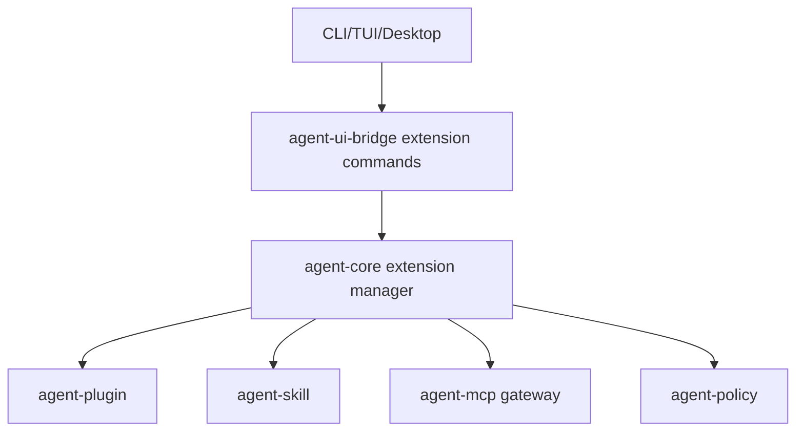

# M22 Extension UX and MCP Gateway Spec

## Purpose

Make extensions installable, inspectable, permissioned, and useful. M22 turns plugin, skill, and MCP contracts into user-facing management flows and a mature MCP gateway that normalizes external tools into the same local policy and audit path as built-ins.

## Product Context

M07 and M11 created MCP, skill, and plugin contracts. Users now need installation, enablement, diagnostics, permission review, health checks, and gateway behavior across CLI, TUI, and Desktop.

## Scope

This milestone delivers:

- plugin install, list, enable, disable, remove, and inspect commands
- skill root management and skill diagnostics
- MCP server lifecycle management with stdio and HTTP transports
- MCP gateway that exposes remote tools as local `agent-tool` entries
- per-plugin and per-MCP capability review
- extension health reports and traceability in UI bridge
- process plugin runtime hardening for production use

Owned by later milestones:

- public marketplace service
- signed third-party plugin distribution
- organization-managed extension policy

## Architecture

`agent-plugin`, `agent-skill`, and `agent-mcp` own extension contracts and discovery. `agent-core` coordinates registration and traceability. UI clients call extension management through typed bridge commands and render summaries.

## Key Contracts

- `ExtensionRegistry`
- `PluginInstallRequest`
- `PluginInstallReport`
- `SkillRootConfig`
- `McpGateway`
- `McpToolAdapter`
- `ExtensionHealthReport`
- `ExtensionCapabilityReview`

Contract rules:

- extension manifests declare capabilities but do not grant them
- MCP tools are registered with source server metadata
- plugin and MCP tool calls route through the same policy, sandbox, audit, and idempotency path as built-ins
- extension enablement is scoped by user and workspace config

## State and Failure Handling

- invalid manifests fail before installation
- missing external binaries produce disabled health reports
- unhealthy MCP servers do not register executable tools
- plugin crashes isolate to the plugin host and emit recoverable diagnostics
- extension removal revokes active leases for that extension

## Security and Privacy

- extension packages are untrusted until validated and approved
- plugin processes receive only scoped environment and capability grants
- MCP server responses are untrusted tool output
- extension logs are redacted and size-limited
- capability reviews must be visible before enablement

## Testing Strategy

- fixture plugin install and enable tests
- MCP gateway tests with fixture servers
- capability review and denial tests
- UI bridge snapshot tests for extension health
- crash and timeout tests for process plugins

## Acceptance Criteria

- Users can install and enable a local process plugin.
- Users can configure an MCP server and run its tools through local policy.
- Extension health and capability requests are visible in CLI/TUI/Desktop-safe formats.
- Extension failures do not crash the runtime.

## Completion Signal

M22 is complete when plugin, skill, and MCP management are usable from terminal surfaces and gateway tools share the normal tool execution path.
