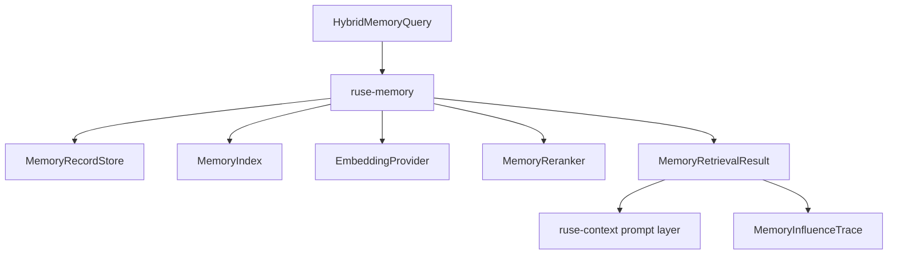

# M23-00 Memory Retrieval Technical Design Spec

## Purpose

Define the architecture for high-quality, privacy-aware memory retrieval before M23 implementation begins. M23 upgrades memory from scoped record storage to hybrid retrieval with embeddings, reranking, write proposals, deletion tombstones, and influence traces.

## Product Context

M05 introduced conversation and project memory records. M12 added memory import/export. Long-lived coding agents need useful recall across sessions while keeping memory inspectable, deletable, scoped, and auditable.

## Scope

This design governs:

- embedding provider abstraction
- memory index and hybrid query model
- lexical and semantic scoring
- reranking interface
- memory influence traces
- memory write proposals
- deletion tombstones and index rebuilds
- privacy and sensitivity rules

Owned by implementation slices:

- `M23-01-embedding-provider-contracts`
- `M23-02-memory-index-hybrid-query`
- `M23-03-memory-rerank-influence-trace`
- `M23-04-memory-write-proposals`
- `M23-05-memory-editor-portability`

## Architecture

`ruse-memory` owns durable memory records, embeddings metadata, indexes, queries, reranking, retention, write proposals, import/export, and deletion tombstones. `ruse-context` consumes selected retrieval results as prompt layers. `ruse-core` emits retrieval and write proposal events.



Dependency rules:

- `ruse-memory` does not depend on `ruse-core` or UI crates.
- embedding providers are pluggable and can be fake, local, or model-backed.
- `ruse-context` decides prompt inclusion from retrieval results and prompt budgets.
- UI clients inspect memory through UI-safe summaries.

## Data Model

Memory records retain existing metadata:

- id
- scope: conversation, project, user, team
- source and source event id
- content
- confidence
- sensitivity
- retention policy
- revision and timestamps

M23 adds:

- embedding model id and vector hash
- lexical index terms
- deletion tombstone id
- last indexed timestamp
- retrieval stats
- influence trace references

Embeddings are derived sensitive data and must follow the sensitivity of the source record.

## Retrieval Flow

`HybridMemoryQuery` includes:

- workspace, conversation, user, optional team and agent ids
- query text
- allowed scopes
- sensitivity ceiling
- lexical weight and semantic weight
- top-k and minimum score
- prompt budget hint

Retrieval flow:

1. filter records by scope, retention, sensitivity, and tombstones
2. run lexical search
3. run semantic search when embeddings are available
4. combine scores deterministically
5. rerank through fixture or configured reranker
6. return selected and optionally rejected candidates with reasons
7. emit influence trace metadata

If embeddings are unavailable, lexical retrieval remains functional.

## Write Proposals

Agent turns may produce `MemoryWriteProposal` records. Proposals are not committed memories until approved by policy or user preference. A proposal stores proposed scope, content summary, source event ids, confidence, sensitivity, and retention.

Write proposal approval can be automatic for low-risk project facts or interactive for user/private memory according to policy.

## Deletion and Rebuild

Deletion creates tombstones. Index rebuilds must respect tombstones and never resurrect deleted records from imports or stale embedding indexes. Import can preserve tombstones or reject archives that conflict with local tombstone policy.

## Security and Privacy

Sensitive memory is excluded from prompt context unless policy permits its scope. Memory influence traces shown in UI redact sensitive content. Embeddings are treated as sensitive and should not be exported by default unless explicitly requested. Users can list, inspect, delete, export, and disable memory scopes.

## Testing Strategy

Required coverage:

- embedding provider fixture tests
- lexical retrieval tests
- semantic fixture retrieval tests
- hybrid scoring and deterministic ordering tests
- sensitivity and scope filter tests
- reranker tests
- influence trace redaction tests
- write proposal approval tests
- tombstone and index rebuild tests

Workspace gates use:

```bash
cargo xtask check
```

## Acceptance Criteria

- Memory retrieval works with lexical-only and hybrid modes.
- Prompt assembly can include selected memories with source metadata.
- Users can inspect why a memory was included.
- Deleted memories do not reappear after rebuild or import.

## Completion Signal

M23 technical design is complete when this document and its plan exist, M23 milestone planning marks the design slice complete, and M23-01 can start without unresolved memory index, embedding, or privacy decisions.
