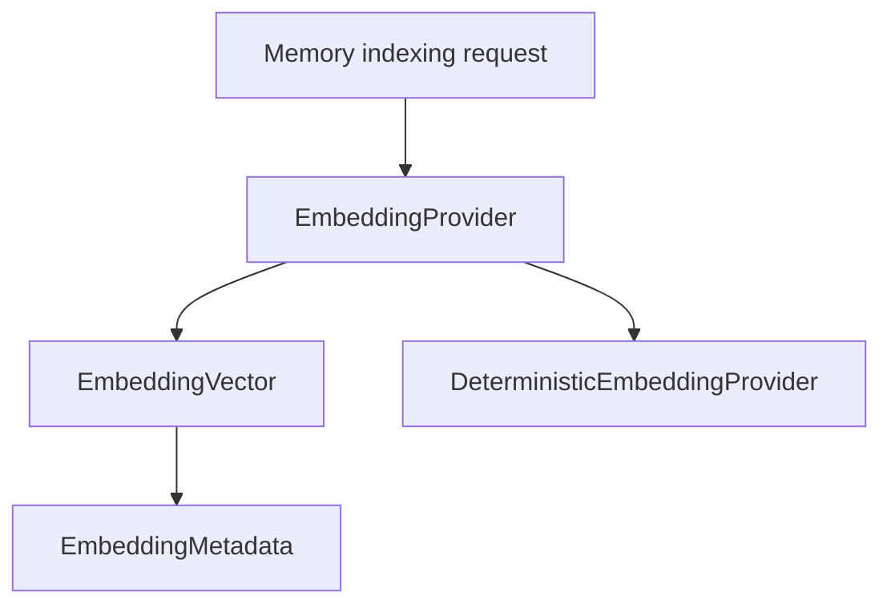

# M23-01 Embedding Provider Contracts Spec

## Purpose

Add provider-agnostic embedding contracts to `agent-memory` so memory retrieval can later use semantic search without coupling memory storage to any concrete model vendor or network transport.

## Product Context

M23 upgrades memory from scoped record listing to quality retrieval. Embeddings are the first dependency because hybrid indexes, reranking, and influence traces need stable vector metadata and deterministic fixture vectors for tests.

## Scope

This spec delivers:

- async `EmbeddingProvider` trait and request/response contracts
- vector metadata including provider id, model id, dimensions, content hash, and sensitivity
- deterministic fixture embedding provider for offline tests
- validation for empty inputs, dimension mismatch, non-finite vector values, and secret-safe diagnostics
- batch embedding behavior with stable input ordering

Owned by other specs:

- hybrid lexical/vector index and query scoring: M23-02
- reranking and influence trace: M23-03
- memory write proposals: M23-04
- tombstones, rebuilds, editor commands, import/export updates: M23-05
- real remote embedding provider configuration: M25 or a later provider milestone

## Architecture

`agent-memory` owns embedding contracts because embeddings are derived memory index data. Provider implementations may live in `agent-memory` for fixtures or later adapter crates, but callers depend only on the trait. `agent-model` is not required for this slice.



Dependency rules:

- `agent-memory` must not depend on `agent-core`, UI crates, or concrete HTTP transports.
- embedding outputs inherit source memory sensitivity.
- fixture embeddings must be deterministic across platforms.

## File Layout

```text
crates/agent-memory/src/
  embedding.rs
  lib.rs
crates/agent-memory/tests/
  embedding_provider.rs
```

## Public Contracts

```rust
#[async_trait::async_trait]
pub trait EmbeddingProvider: Send + Sync {
    async fn embed(&self, request: EmbeddingRequest) -> Result<EmbeddingBatch, MemoryError>;
}

pub struct EmbeddingRequest {
    pub provider_id: String,
    pub model_id: String,
    pub inputs: Vec<EmbeddingInput>,
    pub expected_dimensions: Option<usize>,
}

pub struct EmbeddingInput {
    pub record_id: String,
    pub text: String,
    pub sensitivity: MemorySensitivity,
}

pub struct EmbeddingVector {
    pub record_id: String,
    pub values: Vec<f32>,
    pub metadata: EmbeddingMetadata,
}

pub struct EmbeddingMetadata {
    pub provider_id: String,
    pub model_id: String,
    pub dimensions: usize,
    pub content_hash: String,
    pub sensitivity: MemorySensitivity,
}
```

All durable or test-visible contracts derive `Clone`, `Debug`, `PartialEq`, `Serialize`, and `Deserialize` where appropriate.

## State and Failure Handling

- empty provider id, model id, record id, or input text returns `MemoryError::InvalidRecord` or a dedicated embedding validation error
- non-finite vector values are rejected
- expected dimension mismatch rejects the whole batch
- duplicate input record ids are rejected before provider execution
- failed batches do not partially update indexes in later slices
- diagnostics redact secret-like input text and never include raw memory content

## Security and Privacy

- embeddings are derived sensitive data and inherit the input sensitivity
- raw input text is not included in errors
- content hashes are stable but do not expose text
- fixture provider must not call network or read environment secrets

## Testing Strategy

- unit tests for request validation, duplicate ids, empty fields, dimension mismatch, and non-finite vectors
- deterministic fixture tests for repeated inputs and stable hashes
- serialization tests for metadata shape
- redaction tests for secret-like input text in errors

## Acceptance Criteria

- `agent-memory` exports embedding provider contracts and deterministic fixture provider.
- A batch request preserves input ordering in output vectors.
- Invalid inputs fail before indexing.
- Focused tests pass with `cargo test -p agent-memory embedding_provider`.

## Completion Signal

M23-01 is complete when embedding contracts, fixture provider, validation tests, and public exports are implemented and M23 planning marks the slice complete.
