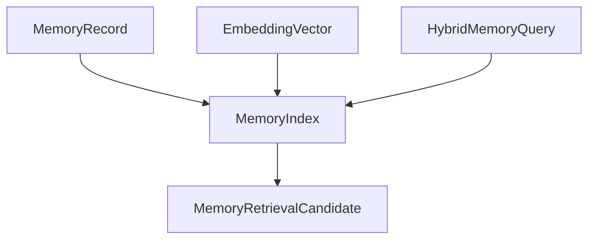

# M23-02 Memory Index and Hybrid Query Spec

## Purpose

Build the local memory index and hybrid query path that combines scope filtering, lexical matching, and optional semantic vector scoring into deterministic retrieval candidates.

## Product Context

M23 needs memory retrieval that is useful before long-term vector infrastructure is mature. This slice makes lexical-only retrieval reliable and adds a semantic lane when M23-01 embeddings are available.

## Scope

This spec delivers:

- `MemoryIndex` contracts for indexing memory records and embedding vectors
- `HybridMemoryQuery` with scope, sensitivity, score, top-k, and prompt-budget controls
- lexical term extraction and scoring
- optional semantic scoring using cosine similarity over stored embeddings
- deterministic score fusion and candidate ordering
- index stats and recoverable diagnostics

Owned by other specs:

- embedding provider contracts: M23-01
- reranking, selected/rejected reasons, and influence traces: M23-03
- write proposals: M23-04
- deletion tombstones, rebuilds, and editor commands: M23-05
- prompt inclusion policy in `ruse-context`: M23-03 or later context integration

## Architecture

`ruse-memory` owns in-memory and future durable index contracts. The index consumes `MemoryRecord` and `EmbeddingVector` values and returns candidates, not prompt layers. `ruse-context` remains responsible for prompt budget assembly.



Dependency rules:

- `ruse-memory` does not depend on `ruse-context`.
- query results carry enough metadata for later prompt assembly and influence traces.
- semantic retrieval is optional; missing embeddings must not break lexical retrieval.

## File Layout

```text
crates/ruse-memory/src/
  index.rs
  embedding.rs
  lib.rs
crates/ruse-memory/tests/
  memory_index_hybrid_query.rs
```

## Public Contracts

```rust
pub struct HybridMemoryQuery {
    pub query_text: String,
    pub query_vector: Option<Vec<f32>>,
    pub allowed_scopes: Vec<MemoryScope>,
    pub sensitivity_ceiling: MemorySensitivity,
    pub lexical_weight: f32,
    pub semantic_weight: f32,
    pub top_k: usize,
    pub minimum_score: f32,
    pub prompt_budget_tokens: Option<u32>,
}

pub struct MemoryRetrievalCandidate {
    pub record: MemoryRecord,
    pub lexical_score: f32,
    pub semantic_score: Option<f32>,
    pub combined_score: f32,
    pub matched_terms: Vec<String>,
}

pub trait MemoryIndex {
    fn upsert_record(&mut self, record: MemoryRecord) -> Result<(), MemoryError>;
    fn upsert_embedding(&mut self, embedding: EmbeddingVector) -> Result<(), MemoryError>;
    fn query(&self, query: HybridMemoryQuery) -> Result<Vec<MemoryRetrievalCandidate>, MemoryError>;
}
```

## State and Failure Handling

- records are keyed by scope and id; upsert replaces the indexed version
- embeddings without matching records are retained as orphan diagnostics or rejected according to implementation choice documented in tests
- query with empty text, empty allowed scopes, zero top-k, invalid weights, non-finite scores, or non-finite query vector values is rejected
- lexical-only retrieval runs when semantic weight is zero or embeddings are missing
- ties are ordered by combined score descending, lexical score descending, then record id ascending

## Security and Privacy

- query sensitivity ceiling filters records before scoring
- sensitive text is not emitted in diagnostics
- matched terms are normalized and safe for UI
- embeddings inherit record sensitivity and are not exported here

## Testing Strategy

- lexical retrieval tests for term matching, top-k, minimum score, and deterministic ties
- semantic fixture tests with known vectors and cosine similarity
- hybrid fusion tests for lexical/semantic weight behavior
- scope and sensitivity filter tests
- invalid query validation tests

## Acceptance Criteria

- `ruse-memory` can index existing memory records and query them lexically.
- Semantic scoring improves ranking when embeddings are present.
- Scope and sensitivity filters run before scoring.
- Focused tests pass with `cargo test -p ruse-memory memory_index_hybrid_query`.

## Completion Signal

M23-02 is complete when hybrid query contracts and tests pass, lexical-only mode works, semantic fixture mode works, and M23 planning marks the slice complete.
