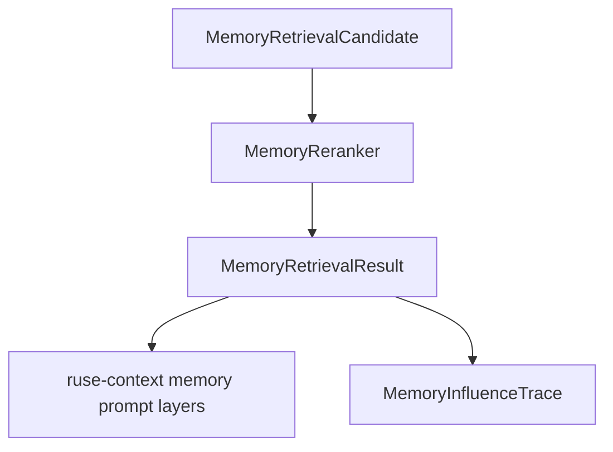

# M23-03 Memory Rerank and Influence Trace Spec

## Purpose

Add reranking and influence trace contracts so memory retrieval can explain which memories were selected, which were rejected, and why those decisions affected prompt context.

## Product Context

Hybrid retrieval alone returns candidates. A production agent needs inspectable selection reasons, budget-aware inclusion, privacy-safe traces, and fixture rerankers before retrieved memory is trusted inside prompts.

## Scope

This spec delivers:

- `MemoryReranker` trait and deterministic fixture reranker
- `MemoryRetrievalResult` with selected and rejected candidates
- selection/rejection reasons and bounded score details
- privacy-safe `MemoryInfluenceTrace`
- conversion from selected memories into prompt-layer inputs without exposing raw sensitive content
- runtime event payload shape for retrieval traces if the existing event model supports it cleanly

Owned by other specs:

- candidate generation and hybrid scoring: M23-02
- memory write proposals: M23-04
- tombstones and editor commands: M23-05
- full Desktop memory inspector UX: later Desktop/settings milestone

## Architecture

`ruse-memory` owns rerank and trace contracts. `ruse-context` consumes selected memories as prompt layers through a small adapter. `ruse-core` may emit retrieval trace events, but does not own scoring or privacy rules.



Dependency rules:

- `ruse-memory` can define prompt-ready summaries, but raw prompt assembly stays in `ruse-context`.
- traces must be serializable and safe for CLI/TUI/Desktop display.
- rerankers must be deterministic in fixture mode.

## File Layout

```text
crates/ruse-memory/src/
  rerank.rs
  trace.rs
  lib.rs
crates/ruse-context/src/
  memory_layers.rs
  lib.rs
crates/ruse-memory/tests/
  memory_rerank_influence_trace.rs
crates/ruse-context/tests/
  memory_prompt_layers.rs
```

## Public Contracts

```rust
pub trait MemoryReranker {
    fn rerank(&self, request: MemoryRerankRequest) -> Result<MemoryRetrievalResult, MemoryError>;
}

pub struct MemoryRerankRequest {
    pub query_text: String,
    pub candidates: Vec<MemoryRetrievalCandidate>,
    pub max_selected: usize,
    pub prompt_budget_tokens: Option<u32>,
}

pub struct MemoryRetrievalResult {
    pub selected: Vec<MemorySelectedCandidate>,
    pub rejected: Vec<MemoryRejectedCandidate>,
    pub trace: MemoryInfluenceTrace,
}

pub struct MemoryInfluenceTrace {
    pub query_hash: String,
    pub selected_count: usize,
    pub rejected_count: usize,
    pub entries: Vec<MemoryInfluenceEntry>,
}
```

Reasons use stable enum/string values such as `score`, `scope`, `sensitivity`, `budget`, `duplicate`, and `below_threshold`.

## State and Failure Handling

- empty candidates return an empty result, not an error
- invalid max-selected or non-finite scores are rejected
- prompt budget trims selected candidates and records `budget` rejection reasons
- duplicate memory ids keep the highest ranked candidate and reject duplicates deterministically
- reranker failure leaves original candidates available for diagnostics but does not mutate memory

## Security and Privacy

- influence trace entries include ids, hashes, scores, reasons, scope, and sensitivity, not raw sensitive memory text
- public memory may expose short excerpts only if marked safe by policy
- sensitive memory excerpts are always omitted or replaced with `[redacted]`
- query text is represented by hash in trace output

## Testing Strategy

- reranker tests for deterministic ordering, max-selected, duplicates, and empty candidates
- budget rejection tests
- influence trace serialization and redaction tests
- context adapter tests that selected memory becomes `PromptLayerKind::Memory`
- tests proving sensitive memory text is not exposed in trace summaries

## Acceptance Criteria

- Reranking produces selected and rejected candidates with stable reasons.
- Influence traces explain retrieval decisions without exposing raw sensitive content.
- Selected memories can be converted into prompt memory layers.
- Focused tests pass with `cargo test -p ruse-memory memory_rerank_influence_trace` and `cargo test -p ruse-context memory_prompt_layers`.

## Completion Signal

M23-03 is complete when rerank contracts, influence traces, prompt-layer adapter tests, and public exports are implemented and M23 planning marks the slice complete.
