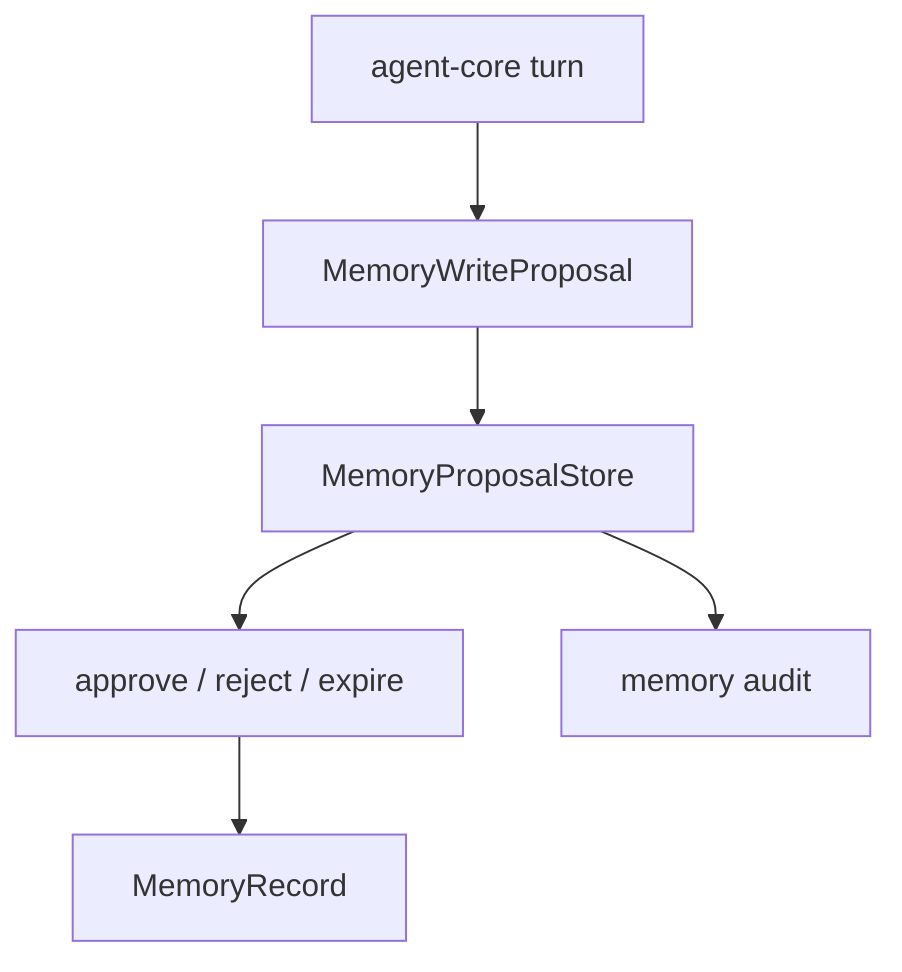

# M23-04 Memory Write Proposals Spec

## Purpose

Introduce memory write proposals so agent turns can suggest new memories without silently committing long-term or sensitive facts.

## Product Context

Useful long-running agents must learn, but uncontrolled memory writes create privacy, correctness, and drift risks. M23-04 creates a reviewed write path with stable state transitions and audit evidence.

## Scope

This spec delivers:

- `MemoryWriteProposal` contracts for proposed content, scope, source events, confidence, sensitivity, and retention
- proposal status transitions: pending, approved, rejected, committed, expired
- in-memory proposal store and validation rules
- automatic approval eligibility metadata for low-risk project memories
- conversion from approved proposals to `MemoryRecord`
- runtime event payloads or audit entries for proposal creation and resolution when integration is clean

Owned by other specs:

- retrieval and influence traces: M23-03
- memory editor and deletion/tombstone commands: M23-05
- policy UI for interactive approval: M19/M21 and later Desktop memory UX
- persistent settings for auto-approval rules: M25

## Architecture

`agent-memory` owns proposal records, store, validation, and conversion to memory records. `agent-core` will later create proposals from turn outputs and persist proposal events. UI clients inspect proposals through safe summaries.



Dependency rules:

- proposal state changes are explicit and idempotent.
- proposal content is redacted in diagnostics and UI summaries.
- committing a proposal uses normal `MemoryStore::add` validation.

## File Layout

```text
crates/agent-memory/src/
  proposal.rs
  lib.rs
crates/agent-memory/tests/
  memory_write_proposals.rs
```

## Public Contracts

```rust
pub enum MemoryProposalStatus {
    Pending,
    Approved,
    Rejected,
    Committed,
    Expired,
}

pub struct MemoryWriteProposal {
    pub proposal_id: String,
    pub proposed_record_id: String,
    pub scope: MemoryScope,
    pub content: String,
    pub summary: String,
    pub source_event_ids: Vec<EventId>,
    pub confidence: u8,
    pub sensitivity: MemorySensitivity,
    pub status: MemoryProposalStatus,
}

pub trait MemoryProposalStore {
    fn add_proposal(&mut self, proposal: MemoryWriteProposal) -> Result<(), MemoryError>;
    fn resolve(&mut self, proposal_id: &str, decision: MemoryProposalDecision) -> Result<MemoryWriteProposal, MemoryError>;
    fn commit(&mut self, proposal_id: &str) -> Result<MemoryRecord, MemoryError>;
}
```

## State and Failure Handling

- proposal ids and proposed record ids must be non-empty and unique while pending
- only pending proposals can be approved, rejected, or expired
- only approved proposals can be committed
- commit is idempotent and returns the existing committed record when repeated
- rejected and expired proposals cannot be committed
- invalid confidence, empty content, empty summary, or unsupported scope returns validation errors before mutation

## Security and Privacy

- user/private or sensitive proposals require explicit approval by default
- automatic approval metadata is only advisory and does not grant policy permission
- diagnostics redact raw content and secret-like text
- proposal summaries may be shown in UI, but full content remains subject to sensitivity policy

## Testing Strategy

- proposal validation tests
- transition tests for approve, reject, expire, commit, duplicate commit, and invalid transitions
- conversion tests from approved proposal to `MemoryRecord`
- auto-approval eligibility tests for low-risk project memory
- redaction tests for diagnostics and serialized summaries

## Acceptance Criteria

- Agent code can create pending memory proposals without committing them.
- Approved proposals convert to valid memory records.
- Invalid or unsafe transitions are rejected deterministically.
- Focused tests pass with `cargo test -p agent-memory memory_write_proposals`.

## Completion Signal

M23-04 is complete when proposal contracts, store transitions, conversion tests, and exports are implemented and M23 planning marks the slice complete.
