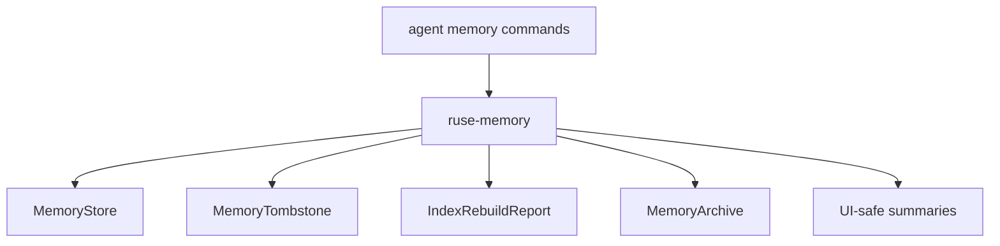

# M23-05 Memory Editor and Portability Spec

## Purpose

Add user-facing memory inspection, deletion tombstones, index rebuild behavior, and import/export portability updates so retrieved memories remain controllable and deletions stay durable.

## Product Context

M23 makes memory more influential. Users need to inspect, delete, export, import, and rebuild memory indexes without deleted memories returning from stale embeddings or archives.

## Scope

This spec delivers:

- memory tombstone contracts and deletion-aware stores
- index rebuild behavior that respects tombstones
- import/export updates that preserve or reject tombstone conflicts according to policy
- CLI memory commands for list, inspect, delete, export, import, and rebuild using fixture/in-memory runtime paths
- UI-safe memory summaries for future TUI/Desktop views
- final M23 smoke coverage across embedding, query, rerank, proposals, tombstones, and portability

Owned by other specs:

- platform paths and durable settings: M25
- Desktop memory editor UX: later Desktop milestone
- remote/vector database backends: later extensibility milestone

## Architecture

`ruse-memory` owns tombstones, rebuild, import/export behavior, and UI-safe summaries. `ruse-cli` exposes thin command rendering over memory runtime contracts. `ruse-ui-bridge` may define portable memory summary frames if needed for JSON output.



Dependency rules:

- CLI does not own memory mutation rules.
- tombstones are checked before import and rebuild.
- raw sensitive memory text is not shown in JSON summaries unless explicitly permitted.

## File Layout

```text
crates/ruse-memory/src/
  tombstone.rs
  editor.rs
  archive.rs
  lib.rs
crates/ruse-cli/src/
  command.rs
crates/ruse-memory/tests/
  memory_editor_portability.rs
crates/ruse-cli/tests/
  memory_commands.rs
```

## Public Contracts

```rust
pub struct MemoryTombstone {
    pub tombstone_id: String,
    pub scope: MemoryScope,
    pub record_id: String,
    pub reason: String,
    pub source_event_id: Option<EventId>,
}

pub struct MemoryEditorSummary {
    pub id: String,
    pub scope: MemoryScope,
    pub sensitivity: MemorySensitivity,
    pub confidence: u8,
    pub source_description: String,
    pub text_preview: Option<String>,
}

pub struct MemoryIndexRebuildReport {
    pub indexed_records: usize,
    pub skipped_tombstoned: usize,
    pub stale_embeddings_removed: usize,
}
```

CLI surface:

```text
agent memory list [--json]
agent memory inspect <id> [--json]
agent memory delete <id> --reason <text> [--json]
agent memory export [--json]
agent memory import <path> [--json]
agent memory rebuild-index [--json]
```

## State and Failure Handling

- deleting a memory creates a tombstone and removes active record/index entries
- repeated delete for the same scoped record is idempotent and returns the existing tombstone
- rebuild skips tombstoned records and drops stale embeddings
- import rejects or skips records matching local tombstones according to explicit import policy
- missing records return recoverable command diagnostics
- corrupted archives fail without mutating current store

## Security and Privacy

- delete reasons are redacted before serialization
- sensitive memory summaries omit `text_preview`
- exports omit embeddings by default
- imports never override tombstones silently
- CLI JSON output uses UI-safe summaries, not raw internal records by default

## Testing Strategy

- tombstone creation and idempotent deletion tests
- rebuild tests for tombstoned records and stale embeddings
- import/export tests preserving tombstone policy and excluding embeddings by default
- CLI text/JSON command tests for list, inspect, delete, export, import, and rebuild
- redaction tests for sensitive memory text and delete reasons
- final M23 smoke test covering the full memory retrieval path

## Acceptance Criteria

- Users can inspect and delete memory through CLI fixtures.
- Deleted records do not reappear after rebuild or import.
- Exports are portable and secret-safe by default.
- Focused tests pass with `cargo test -p ruse-memory memory_editor_portability` and `cargo test -p ruse-cli memory_commands`.

## Completion Signal

M23-05 is complete when memory editor commands, tombstones, rebuild/import/export behavior, final smoke coverage, and docs status are complete.
