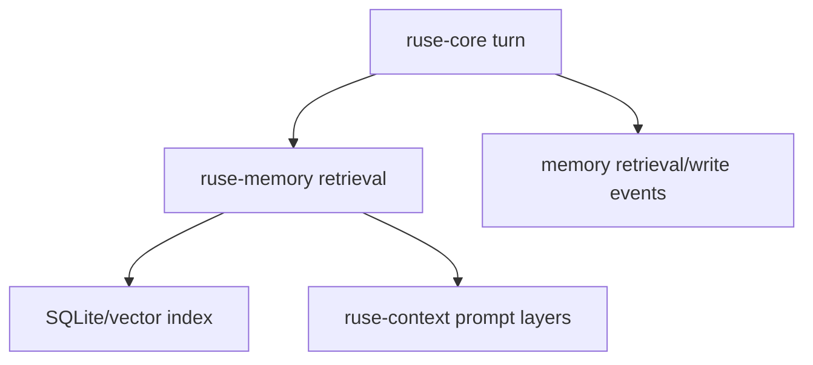

# M23 Memory Retrieval Quality Spec

## Purpose

Upgrade memory from scoped record storage to high-quality retrieval that improves agent behavior without harming privacy, auditability, or reproducibility. M23 adds embeddings, hybrid search, reranking hooks, retention controls, and user-editable memory views.

## Product Context

M05 and M12 created conversation/project memory and memory portability. Real long-lived agents need relevant recall across sessions, project conventions, user preferences, and prior experiences while still making memory use inspectable and deletable.

## Scope

This milestone delivers:

- embedding provider abstraction
- local SQLite-backed memory index and optional vector index backend
- hybrid lexical and semantic retrieval
- reranking interface with deterministic fixture implementation
- memory write proposals from turns with approval policy
- memory editor contracts for CLI/TUI/Desktop
- retrieval traces that explain which memories influenced a prompt

Owned by later milestones:

- remote managed memory services
- cross-device sync
- organization-wide shared memory

## Architecture

`ruse-memory` owns records, embeddings metadata, retrieval, retention, import/export, and memory mutation proposals. `ruse-context` asks memory for scoped candidates and turns them into prompt layers. `ruse-core` records memory retrieval and write events.

## Key Contracts

- `EmbeddingProvider`
- `EmbeddingVector`
- `MemoryIndex`
- `HybridMemoryQuery`
- `MemoryRetrievalResult`
- `MemoryReranker`
- `MemoryWriteProposal`
- `MemoryInfluenceTrace`

Contract rules:

- memories retain scope, sensitivity, source, confidence, retention, and revision metadata
- retrieval returns both selected records and rejected candidates with safe reasons when requested
- write proposals are separate from committed memories
- deletion tombstones prevent deleted memory from reappearing through import or index rebuild

## State and Failure Handling

- missing embedding provider falls back to lexical search
- stale embeddings are refreshed by background maintenance
- index corruption triggers rebuild from durable records
- failed memory writes do not fail the user turn unless memory was required
- low-confidence memories can be excluded from prompt layers by policy

## Security and Privacy

- sensitive memory is excluded from prompts unless policy allows the scope
- memory retrieval traces redact sensitive values in UI views
- embeddings are treated as derived sensitive data
- users can inspect, export, delete, and disable memory scopes

## Testing Strategy

- unit tests for lexical, semantic fixture, and hybrid ranking
- retention and deletion tombstone tests
- context integration tests proving selected memories become prompt layers
- privacy tests for sensitive memory redaction
- index rebuild tests

## Acceptance Criteria

- Runtime can retrieve relevant project and user memories for a turn.
- Users can inspect why a memory was included.
- Memory can be deleted and stays deleted after index rebuild/import.
- Retrieval quality can improve through provider plugins without changing core runtime.

## Completion Signal

M23 is complete when hybrid memory retrieval affects prompt assembly through auditable traces and privacy controls pass regression tests.
