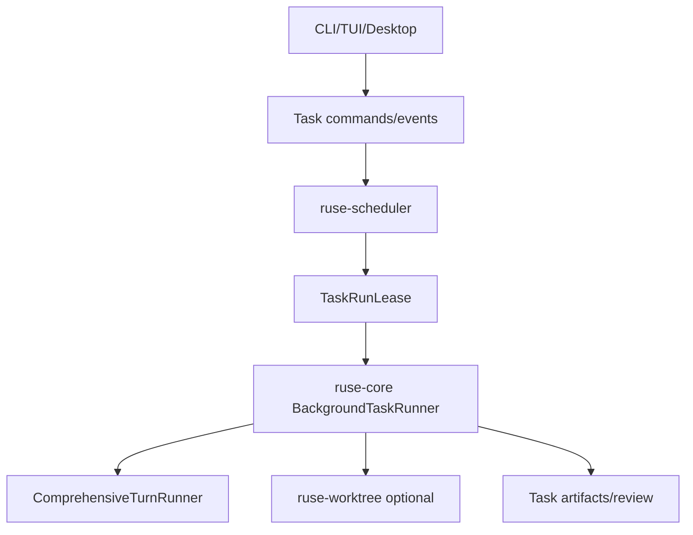

# M24-00 Background Agents Technical Design Spec

## Purpose

Define the architecture for background and scheduled agent UX before M24 implementation begins. M24 connects durable scheduler contracts, comprehensive turn execution, approvals, notifications, quotas, retries, artifacts, traces, and UI controls.

## Product Context

M08 created scheduler state, queue, leases, retries, quotas, and notifications. M18 and M19 provide comprehensive turns and approvals. M24 makes long-running and recurring agent work usable from CLI, TUI, and Desktop-facing bridge surfaces.

## Scope

This design governs:

- background task command model
- task runner integration with comprehensive turns
- approval waiting and notification behavior
- quota and retry enforcement
- stale lease recovery
- artifact and review summary model
- CLI/TUI/Desktop task inspection boundaries

Owned by implementation slices:

- `M24-01-task-command-bridge`
- `M24-02-background-turn-runner`
- `M24-03-task-approvals-notifications`
- `M24-04-task-quotas-retries-recovery`
- `M24-05-task-artifacts-review`

## Architecture

`ruse-scheduler` owns task definitions, run state, queueing, leases, retries, and quotas. `ruse-core` owns executing task turns and emitting runtime events. `ruse-ui-bridge` exposes task commands and notifications. `ruse-worktree` provides isolation for coding tasks when configured.



Dependency rules:

- scheduler does not know model or tool internals
- core executes leased tasks and reports state back to scheduler
- UI clients mutate tasks only through typed commands
- background tasks use explicit capability scopes and quotas

## Task Model

`BackgroundAgentTask` includes:

- task id, workspace id, conversation id
- schedule: one-shot or cron-like recurrence
- prompt or handoff input
- agent profile and model selection
- capability scope
- quota policy
- retry policy
- worktree isolation mode
- status and latest run summary

`TaskRun` includes:

- run id
- attempt number
- lease id
- state
- checkpoint ids
- approval ids
- artifact ids
- trace id
- start/end timestamps

## Command and UI Surface

Commands:

- create task
- list tasks
- inspect task
- pause/resume task
- cancel task/run
- retry failed run
- update schedule
- open trace
- review artifacts

UI bridge events:

- task created
- queued
- running
- waiting approval
- paused
- sleeping
- succeeded
- failed
- cancelled
- notification

## Runner Behavior

The runner leases a task, creates or resumes a conversation, optionally provisions a worktree, executes a comprehensive turn, and writes artifacts and summaries. Approvals pause active execution and release compute leases where appropriate. Completion records final state, trace, and review summary.

Recurring tasks create separate runs linked to one task definition.

## Quotas, Retries, and Recovery

Quota dimensions:

- concurrent tasks per workspace
- model calls
- tool calls
- wall-clock time
- output bytes
- worktree count

Retries use configured backoff and preserve failed traces. Startup recovery reconciles persisted running leases with current process state. Expired leases return to queued or failed according to policy.

## Security and Privacy

Background tasks run under explicit task capability scopes. Recurring schedules cannot silently broaden permissions. Notifications are summaries only. Worktree cleanup respects review retention. Approval waits do not auto-approve after timeout.

## Testing Strategy

Required coverage:

- task command schema tests
- scheduler lease integration tests
- background turn runner fixture tests
- approval pause/resume tests
- quota exhaustion tests
- stale lease recovery tests
- retry exhaustion tests
- artifact and review summary serialization tests
- UI bridge notification snapshot tests

Workspace gates use:

```bash
cargo xtask check
```

## Acceptance Criteria

- Users can create, list, inspect, pause, resume, and cancel background tasks.
- Tasks can run comprehensive turns with durable traces.
- Approvals pause and resume tasks safely.
- Quotas and retries are enforced and visible.

## Completion Signal

M24 technical design is complete when this document and its plan exist, M24 milestone planning marks the design slice complete, and M24-01 can start without unresolved task, quota, or recovery decisions.
