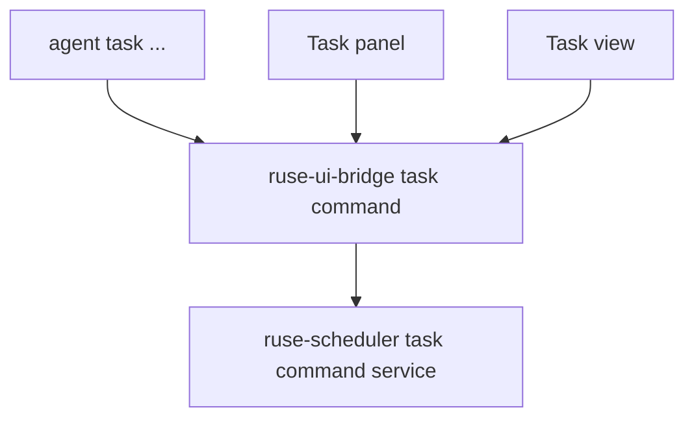

# M24-01 Task Command Bridge Spec

## Purpose

Expose background task management through typed scheduler, UI bridge, CLI, TUI, and Desktop-safe contracts before task execution is connected to full agent turns.

## Product Context

M08 added scheduler queue, lease, notification, retry, and quota primitives. M21 and M22 proved shared CLI/TUI/Desktop bridge patterns. M24-01 turns scheduler state into a usable command surface for creating, listing, inspecting, pausing, resuming, cancelling, and scheduling background tasks.

## Scope

This spec delivers:

- `BackgroundAgentTask` task definition contracts
- task command request/response contracts in `ruse-scheduler` and `ruse-ui-bridge`
- CLI `agent task` commands for create, list, inspect, pause, resume, cancel, and schedule updates
- TUI and Desktop-safe task summary models
- JSON output shape for task commands

Owned by other specs:

- comprehensive turn execution: M24-02
- approval waiting notifications: M24-03
- quota/retry/recovery enforcement: M24-04
- artifacts and review summaries: M24-05

## Architecture

`ruse-scheduler` owns task definitions and command state transitions. `ruse-ui-bridge` owns UI-safe command and snapshot schemas. `ruse-cli`, `ruse-tui`, and `ruse-desktop` render the same bridge summaries and do not own mutation rules.



Dependency rules:

- UI crates do not mutate `TaskRun` directly
- command results are serializable and redacted
- CLI fixture runtime is allowed until M25 platform paths exist

## File Layout

```text
crates/ruse-scheduler/src/
  command.rs
  lib.rs
crates/ruse-ui-bridge/src/
  frame.rs
  command.rs
crates/ruse-cli/src/
  command.rs
crates/ruse-tui/src/
  task_panel.rs
crates/ruse-desktop/src/
  task.rs
crates/ruse-scheduler/tests/
  task_command_bridge.rs
crates/ruse-cli/tests/
  task_commands.rs
```

## Public Contracts

```rust
pub struct BackgroundAgentTask {
    pub task_id: TaskId,
    pub workspace_id: WorkspaceId,
    pub conversation_id: Option<ConversationId>,
    pub prompt: String,
    pub schedule: TaskSchedule,
    pub state: TaskState,
    pub priority: TaskPriority,
}

pub enum TaskCommand {
    Create(TaskCreateRequest),
    List,
    Inspect { task_id: TaskId },
    Pause { task_id: TaskId, reason: String },
    Resume { task_id: TaskId, reason: String },
    Cancel { task_id: TaskId, reason: String },
    UpdateSchedule(TaskScheduleUpdate),
}
```

UI summaries expose ids, state, priority, schedule, timestamps, prompt summary, and latest run summary. They do not expose raw sensitive prompt content once task sensitivity is introduced.

## State and Failure Handling

- create validates non-empty prompt, workspace id, schedule, and priority
- pause/resume/cancel delegate to scheduler transitions
- inspect missing task returns recoverable command diagnostics
- schedule updates cannot modify terminal tasks
- repeated pause/cancel on terminal state returns a deterministic invalid-transition error

## Security and Privacy

- command reasons are redacted before serialization
- prompt summaries are bounded and secret-like text is redacted
- future capability scopes are represented but not broadened by command updates

## Testing Strategy

- scheduler command tests for create/list/inspect/pause/resume/cancel/update schedule
- UI bridge snapshot tests for task summaries and command errors
- CLI text and JSON command tests
- TUI/Desktop model tests for task summaries

## Acceptance Criteria

- `agent task create --prompt ...` returns a created task summary.
- `agent task list|inspect|pause|resume|cancel` works against a fixture runtime.
- UI bridge serializes task snapshots with stable snake-case JSON.
- Focused tests pass with `cargo test -p ruse-scheduler task_command_bridge` and `cargo test -p ruse-cli task_commands`.

## Completion Signal

M24-01 is complete when task command contracts, UI-safe summaries, CLI commands, tests, exports, and M24 planning status are updated.
