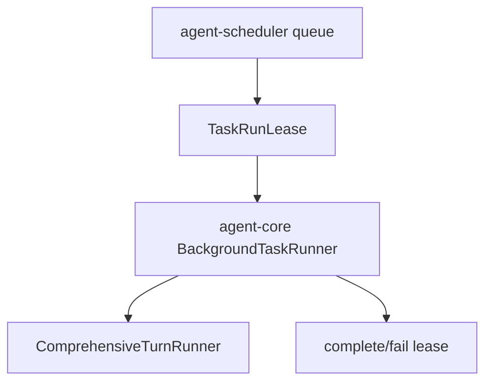

# M24-02 Background Turn Runner Spec

## Purpose

Connect leased background tasks to comprehensive agent turn execution so queued tasks can run, produce runtime events, and persist completion or failure state.

## Product Context

M18 provides comprehensive turn execution and M24-01 exposes task controls. M24-02 adds the runner that leases a task, builds turn input, runs a model/tool loop fixture, and records task run results without adding approval or quota complexity yet.

## Scope

This spec delivers:

- `BackgroundTaskRunner` in `agent-core`
- scheduler lease acquisition and completion/failure integration
- task run input mapping from `BackgroundAgentTask`
- runtime event trace ids and checkpoint references in run result summaries
- fixture runner tests using fake providers and tools

Owned by other specs:

- approval pause/resume: M24-03
- quotas, retry exhaustion, stale leases: M24-04
- artifacts and review summaries: M24-05

## Architecture

`agent-core` owns runner orchestration and consumes `agent-scheduler` leases. `agent-scheduler` remains model/tool agnostic. Storage receives runtime events through existing event store contracts.



## File Layout

```text
crates/agent-core/src/
  background.rs
  lib.rs
crates/agent-core/tests/
  background_turn_runner.rs
```

## Public Contracts

```rust
pub struct BackgroundTaskRunnerInput {
    pub worker_id: String,
    pub now: Timestamp,
}

pub struct BackgroundTaskRunOutcome {
    pub task_id: TaskId,
    pub final_state: TaskState,
    pub event_count: usize,
    pub trace_id: Option<String>,
    pub summary: String,
}
```

## State and Failure Handling

- runner acquires one ready task lease at a time
- no ready task returns `Ok(None)`
- successful final response completes the lease
- model/tool failure fails the lease and preserves partial trace information
- cancellation token support is passed through if available but detailed cancellation UX is M24-04

## Security and Privacy

- task prompt and model output are persisted through existing redaction/audit paths
- runner does not grant permissions; policy remains in tool loop
- worker ids are validated and included in trace metadata

## Testing Strategy

- no-ready-task fixture test
- successful background turn fixture test
- failed turn marks lease failed
- emitted events remain replayable
- scheduler does not know model/provider internals

## Acceptance Criteria

- A queued task can be leased and completed by `BackgroundTaskRunner`.
- Failed model/tool execution marks the task failed or retryable according to scheduler output.
- Focused tests pass with `cargo test -p agent-core background_turn_runner`.

## Completion Signal

M24-02 is complete when the runner executes fixture turns through shared core contracts and M24 planning advances to approvals and notifications.
