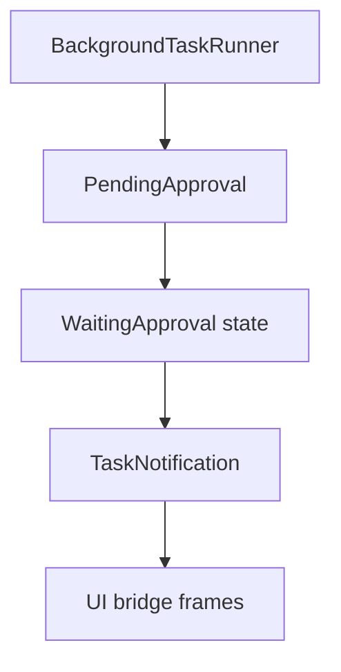

# M24-03 Task Approvals and Notifications Spec

## Purpose

Make background tasks pause safely when a tool or policy decision requires user approval, and notify CLI/TUI/Desktop clients without keeping active compute leases open.

## Product Context

M19 introduced durable approval contracts and M24-02 runs leased background turns. M24-03 connects approval waits to task state and notification surfaces so unattended tasks become reviewable instead of silently failing or blocking resources.

## Scope

This spec delivers:

- background approval wait state mapping
- task notifications for queued, running, waiting approval, resumed, cancelled, succeeded, and failed
- UI bridge frames for approval-linked task notifications
- CLI/TUI/Desktop-safe notification rendering
- resume path after approval decision

Owned by other specs:

- retry and stale lease recovery: M24-04
- final artifacts and review summaries: M24-05

## Architecture

`agent-core` detects approval suspension from comprehensive turn output and asks `agent-scheduler` to transition the task to `WaitingApproval`. `agent-scheduler` emits `TaskNotification`. `agent-ui-bridge` normalizes notifications.



## Public Contracts

```rust
pub struct BackgroundApprovalWait {
    pub task_id: TaskId,
    pub approval_id: ApprovalRequestId,
    pub lease_released: bool,
    pub summary: String,
}

pub struct UiTaskNotification {
    pub task_id: String,
    pub kind: String,
    pub summary: String,
    pub approval_id: Option<String>,
}
```

## State and Failure Handling

- approval suspension transitions running task to waiting approval
- active compute lease is completed or released according to scheduler policy
- approval denial cancels or fails the task with an audit reason
- approval allow resumes the task from checkpoint or queued continuation
- duplicate notifications are deduplicated by task id, kind, and approval id

## Security and Privacy

- notification summaries are redacted and bounded
- pending approval previews follow M19 redaction rules
- approval timeout never auto-approves

## Testing Strategy

- background turn suspends on `PolicyDecision::Ask`
- notification sink receives waiting approval event
- approval allow resumes queued continuation
- approval deny does not execute the tool
- UI bridge snapshot redacts approval/task summaries

## Acceptance Criteria

- Background tasks visibly enter waiting approval state.
- Approval decisions resume, fail, or cancel tasks deterministically.
- Focused tests pass with `cargo test -p agent-core background_task_approvals` and `cargo test -p agent-ui-bridge task_notifications`.

## Completion Signal

M24-03 is complete when approval waits and notifications are integrated across scheduler, core, and UI bridge tests.
