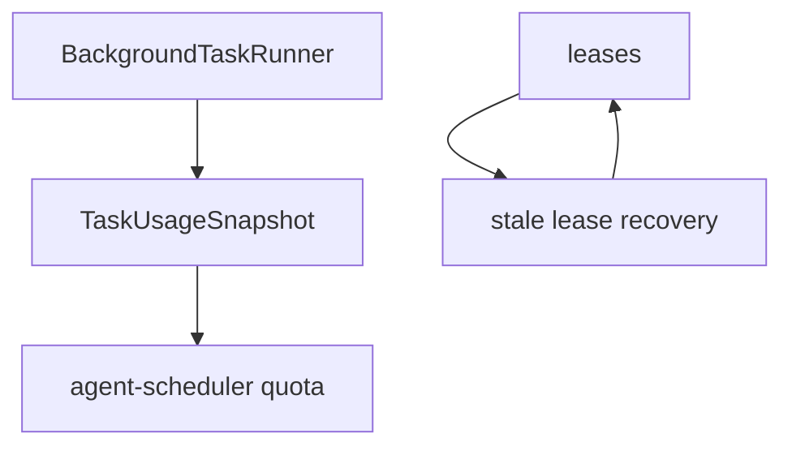

# M24-04 Task Quotas, Retries, and Recovery Spec

## Purpose

Enforce resource limits and make background task execution recoverable after failures, stale leases, retries, and process restarts.

## Product Context

M08 introduced quota and retry primitives. M24-02 and M24-03 run and pause tasks. M24-04 hardens task execution so long-running work is bounded, retryable, and recoverable.

## Scope

This spec delivers:

- quota accounting for running tasks, model calls, tool calls, wall time, output bytes, and worktree count
- retry attempts and backoff visibility
- stale lease recovery report
- cancellation and pause propagation to active runner tasks
- CLI/UI summaries for quota and retry states

Owned by other specs:

- artifact/review output: M24-05
- platform startup migration and daemon behavior: M25 or later

## Architecture

`agent-scheduler` owns quota and retry decisions. `agent-core` reports usage snapshots and obeys cancellation. Storage or future durable runtime keeps recovery inputs.



## Public Contracts

```rust
pub struct TaskUsageSnapshot {
    pub model_calls: u32,
    pub tool_calls: u32,
    pub output_bytes: u64,
    pub elapsed_ms: u64,
    pub worktree_count: u32,
}

pub struct TaskRecoveryReport {
    pub expired_leases: usize,
    pub requeued_tasks: usize,
    pub failed_tasks: usize,
}
```

## State and Failure Handling

- quota rejection leaves task queued or failed with visible reason
- retryable failure transitions to sleeping until backoff expires
- retry exhaustion creates terminal failed state
- stale active leases expire and requeue or fail according to policy
- cancellation propagates to runner before terminal state

## Security and Privacy

- quota/retry diagnostics do not include raw prompts, tool inputs, or provider secrets
- recurring tasks cannot gain new capability scopes during recovery
- cancellation and stale lease recovery are audit-worthy state changes

## Testing Strategy

- quota exhaustion tests for each dimension
- retry backoff and exhaustion tests
- stale lease recovery tests
- cancellation propagation tests
- CLI/UI summary tests for quota and recovery reports

## Acceptance Criteria

- Tasks respect configured quotas.
- Retry and recovery decisions are deterministic and inspectable.
- Focused tests pass with `cargo test -p agent-scheduler task_quotas_retries_recovery`.

## Completion Signal

M24-04 is complete when quota, retry, cancellation, and stale lease recovery behavior is covered and M24 advances to artifacts/review.
