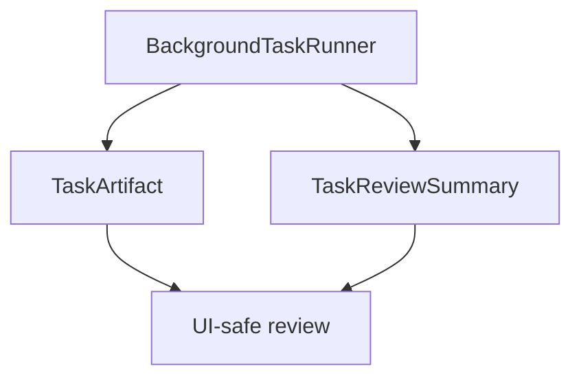

# M24-05 Task Artifacts and Review Spec

## Purpose

Persist and present background task outputs, traces, and completion summaries so users can review long-running agent work after it finishes or fails.

## Product Context

M24-01 through M24-04 make tasks controllable, runnable, approvable, and recoverable. M24-05 completes the user workflow with artifacts, trace links, and review summaries across CLI/TUI/Desktop-facing surfaces.

## Scope

This spec delivers:

- `TaskArtifact` and `TaskReviewSummary` contracts
- artifact collection from background runner outputs
- trace and checkpoint references in review summaries
- CLI/TUI/Desktop-safe review rendering
- final M24 smoke coverage across create, run, approval, quota, retry, artifact, and review paths

Owned by other specs:

- durable platform artifact directories: M25
- rich Desktop artifact viewer: later Desktop milestone

## Architecture

`ruse-core` produces task artifact metadata and review summaries. `ruse-scheduler` links artifacts to task runs. `ruse-ui-bridge`, CLI, TUI, and Desktop render safe summaries.



## Public Contracts

```rust
pub struct TaskArtifact {
    pub artifact_id: String,
    pub task_id: TaskId,
    pub kind: TaskArtifactKind,
    pub path: Option<String>,
    pub content_hash: Option<String>,
    pub summary: String,
}

pub struct TaskReviewSummary {
    pub task_id: TaskId,
    pub final_state: TaskState,
    pub trace_id: Option<String>,
    pub artifact_ids: Vec<String>,
    pub summary: String,
}
```

## State and Failure Handling

- successful tasks produce a review summary even if no artifacts exist
- failed tasks preserve trace and failure summary
- missing artifact paths render diagnostics, not panics
- artifact summaries are immutable after task reaches terminal state

## Security and Privacy

- artifact summaries are redacted and bounded
- raw artifact content is not embedded in UI snapshots by default
- local paths are normalized and can be redacted for portable reports

## Testing Strategy

- artifact serialization tests
- review summary tests for success and failure
- UI bridge snapshot tests
- CLI/TUI/Desktop model tests for review summaries
- final M24 smoke test through the background task lifecycle

## Acceptance Criteria

- Completed background tasks produce reviewable summaries and artifact metadata.
- Failed tasks keep trace and failure context.
- Focused tests pass with `cargo test -p ruse-core task_artifacts_review` and `cargo test -p ruse-ui-bridge task_review`.

## Completion Signal

M24-05 and M24 are complete when artifact/review contracts, surfaces, final smoke coverage, docs status, and workspace gates are complete.
