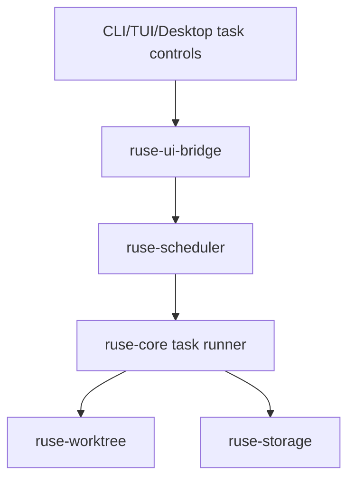

# M24 Background Agents UX Spec

## Purpose

Make long-running and scheduled agents usable as first-class product workflows. M24 connects scheduler contracts, durable tasks, approvals, notifications, traces, and UI surfaces so users can start, monitor, pause, resume, and review background work.

## Product Context

M08 created scheduler contracts and M09 introduced subagent isolation. The runtime needs a product layer for recurring checks, long-running coding tasks, approval pauses, resource budgets, and completion review.

## Scope

This milestone delivers:

- CLI/TUI/Desktop commands to create, list, pause, resume, cancel, and inspect tasks
- durable background task runner integration with comprehensive turns
- approval waiting state and notification routing
- task quotas for model calls, tools, wall time, concurrency, and workspace resources
- task artifacts, summaries, traces, and optional worktree output
- retry and backoff policies visible to users

Owned by later milestones:

- hosted cloud execution
- team/organization scheduling controls
- mobile notifications

## Architecture

`ruse-scheduler` owns task states, queues, leases, retries, and quotas. `ruse-core` runs task turns and emits events. UI clients manage tasks through `ruse-ui-bridge`. `ruse-worktree` provides isolation for coding tasks when requested.

## Key Contracts

- `BackgroundAgentTask`
- `TaskRunRequest`
- `TaskRunLease`
- `TaskQuotaPolicy`
- `TaskNotification`
- `TaskArtifact`
- `TaskReviewSummary`
- `CronScheduleConfig`

Contract rules:

- background tasks have durable conversation and task ids
- approvals pause tasks without consuming active execution leases
- task retries preserve previous traces and create new run attempts
- recurring schedules produce separate runs linked to one task definition

## State and Failure Handling

- lost leases expire and return tasks to queued or failed state by policy
- cancelled tasks signal model streams and tools before terminal state
- paused tasks keep checkpoints and pending approvals
- retry exhaustion produces a reviewable failure summary
- startup recovery reconciles running leases with persisted state

## Security and Privacy

- background tasks run under explicit task capability scopes
- recurring schedules cannot silently broaden permissions
- notifications contain summaries, not raw secrets or sensitive tool output
- worktree cleanup respects configured retention and user review windows

## Testing Strategy

- scheduler integration tests for create, lease, run, pause, resume, cancel, and retry
- approval pause/resume tests for background turns
- quota exhaustion tests
- recovery tests for stale leases
- UI bridge snapshot tests for task notifications

## Acceptance Criteria

- Users can create and monitor a background agent task.
- Tasks pause for approval and resume correctly.
- Quotas and retries are enforced and visible.
- Completion produces trace, summary, and artifacts.

## Completion Signal

M24 is complete when background tasks are usable from terminal and Desktop-facing bridge surfaces with durable recovery.
