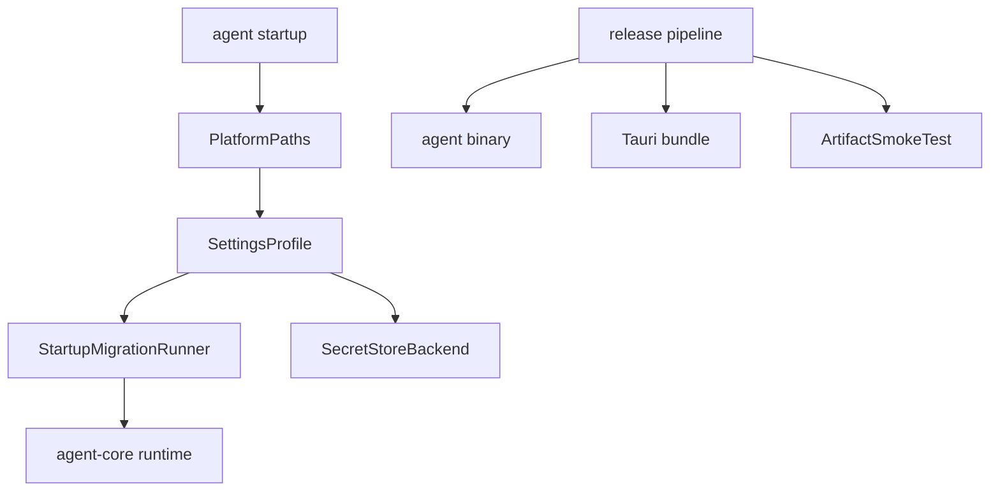

# M25-00 Packaging and Release Technical Design Spec

## Purpose

Define the architecture for packaging, settings, secrets, migrations, and updates before M25 implementation begins. M25 prepares `agent` for repeatable local distribution across CLI and Desktop.

## Product Context

M16-M24 build the product capabilities. M25 makes them installable and maintainable through stable platform paths, OS keychain integration, startup migrations, release artifacts, Desktop bundles, updater hooks, and smoke tests.

## Scope

This design governs:

- platform path resolution
- settings profile and mutation model
- OS keychain and env secret backends
- startup migration runner
- CLI release packaging
- Desktop bundle and updater metadata
- release artifact smoke testing
- failure and rollback behavior

Owned by implementation slices:

- `M25-01-platform-paths-settings`
- `M25-02-os-keychain-secret-store`
- `M25-03-startup-migrations`
- `M25-04-cli-release-packaging`
- `M25-05-desktop-bundle-updater`

## Architecture

Packaging and startup behavior are shared across surfaces. `agent-cli` exposes the `agent` binary. The Desktop app bundles runtime through Tauri. `agent-core` loads effective settings after migrations. `agent-storage`, `agent-memory`, and plugin/config stores participate in migration planning. `agent-model` owns secret resolver traits and keychain adapters.



Dependency rules:

- platform path resolution is shared by CLI, TUI, Desktop, and background tasks
- config files store secret references, not raw values
- migrations run before runtime side effects
- release tooling does not store signing keys in repository config

## Platform Paths

`PlatformPaths` resolves:

- config directory
- data directory
- cache directory
- logs directory
- plugins directory
- skills directory
- memory/index directory
- temp/worktree directory

Paths are platform-specific and testable through fixtures. Overrides are allowed through explicit environment variables or config flags for tests and portable installations.

## Settings Model

`SettingsProfile` includes:

- model provider catalog and selected model
- prompt profile selection
- policy defaults
- memory settings
- MCP server settings
- plugin settings
- UI preferences
- background task defaults
- release channel

Settings mutations are typed, validated, and auditable. Invalid changes do not partially persist.

## Secret Store

Secret backends:

- OS keychain default when available
- environment resolver fallback
- in-memory fixture for tests

Secret store APIs work with `SecretRef`. They return redacted diagnostics and never serialize raw values. Desktop secret entry writes to keychain and stores only refs.

## Startup Migrations

Startup migration stages:

1. read current schema versions
2. build migration plan
3. check backups or rollback strategy
4. apply idempotent migrations
5. verify output versions
6. record audit entry
7. start runtime

Migrations cover config, storage, memory, plugin manifests, and prompt/profile schemas.

## Release Artifacts

CLI packaging:

- `agent` binary for macOS, Linux, Windows
- version command
- config path diagnostics
- smoke prompt with fake provider

Desktop packaging:

- Tauri bundle
- app metadata
- update manifest handling
- local smoke launch

Release channels:

- dev
- beta
- stable

Update failures must leave the current version usable.

## Security and Privacy

Signing keys and release tokens are external secrets. Release logs redact tokens. Settings export omits secrets by default. Update metadata is verified before use. Migration backups and logs do not include raw secret values.

## Testing Strategy

Required coverage:

- platform path fixture tests for macOS, Linux, Windows expectations
- settings mutation validation tests
- secret store fixture and env fallback tests
- migration idempotency and failure tests
- CLI artifact smoke tests
- Desktop bundle smoke tests defined by Tauri slice
- update manifest validation tests

Workspace gates use:

```bash
cargo xtask check
```

## Acceptance Criteria

- `agent` can be packaged and run as a CLI artifact.
- Desktop can be bundled locally.
- settings, secrets, and migrations behave consistently across surfaces.
- failed migrations and failed updates are safe and diagnosable.

## Completion Signal

M25 technical design is complete when this document and its plan exist, M25 milestone planning marks the design slice complete, and M25-01 can start without unresolved platform path, secret, migration, or release-channel decisions.
