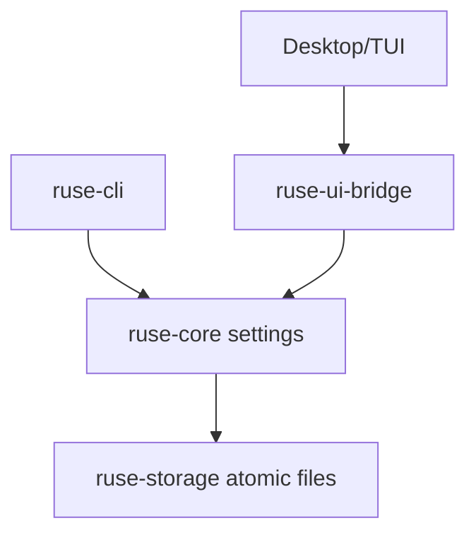

# M25-01 Platform Paths and Settings Spec

## Purpose

Define shared platform directory resolution and typed settings profiles so CLI, TUI, Desktop, background tasks, plugins, memory, and logs use the same local layout and safe configuration model.

## Product Context

M25 turns the runtime into an installable product. Stable paths and settings are the first release prerequisite because migrations, secrets, packaging smoke tests, and Desktop startup all depend on deterministic local locations.

## Scope

This spec delivers:

- `PlatformPaths` contract for config, data, cache, logs, plugins, skills, memory, and temp/worktree roots
- explicit path override model for tests and portable installs
- `SettingsProfile` and `SettingsMutation` contracts
- settings validation, redaction, and atomic write behavior
- CLI diagnostics for resolved paths and effective settings
- UI-safe settings snapshot fields for Desktop/TUI

Owned by other specs:

- OS keychain storage and secret material access: M25-02
- startup migration execution: M25-03
- release artifact generation: M25-04 and M25-05

## Architecture

`ruse-core` owns platform path and settings contracts used by runtime startup. `ruse-storage` persists settings files atomically. `ruse-cli` exposes diagnostics and mutation commands. `ruse-ui-bridge` carries UI-safe snapshots.



## Public Contracts

```rust
pub struct PlatformPaths {
    pub config_dir: PathBuf,
    pub data_dir: PathBuf,
    pub cache_dir: PathBuf,
    pub log_dir: PathBuf,
    pub plugin_dir: PathBuf,
    pub skill_dir: PathBuf,
    pub memory_dir: PathBuf,
    pub temp_dir: PathBuf,
}

pub struct SettingsProfile {
    pub profile_id: String,
    pub selected_provider: Option<String>,
    pub selected_model: Option<String>,
    pub policy_profile: String,
    pub release_channel: ReleaseChannel,
}

pub enum SettingsMutation {
    SetModel { provider: String, model: String },
    SetReleaseChannel(ReleaseChannel),
    SetPathOverride { key: String, path: PathBuf },
}
```

## State and Failure Handling

- path resolution is pure and deterministic for a given platform and override set
- invalid path overrides fail before settings mutation is persisted
- settings writes use temp file plus atomic rename where supported
- corrupted settings return diagnostics and safe defaults without losing the original file
- invalid mutations return recoverable validation errors

## Security and Privacy

- settings files store secret references only
- diagnostics redact secret-like values and home-relative sensitive fragments where needed
- path overrides are explicit and never inferred from untrusted prompts
- Desktop snapshots do not expose raw environment values

## Testing Strategy

- fixture tests for macOS, Linux, and Windows path expectations
- settings validation tests for valid and invalid mutations
- atomic write and corrupted-file recovery tests
- CLI diagnostics tests for redaction
- UI bridge snapshot tests for settings shape

## Acceptance Criteria

- every surface can request the same `PlatformPaths`
- settings can be loaded, mutated, validated, persisted, and rendered safely
- focused tests pass with `cargo test -p ruse-core platform_paths_settings`

## Completion Signal

M25-01 is complete when shared path/settings contracts exist, CLI/UI diagnostics are covered, and settings persistence is safe for M25-02 secret references and M25-03 migrations.
