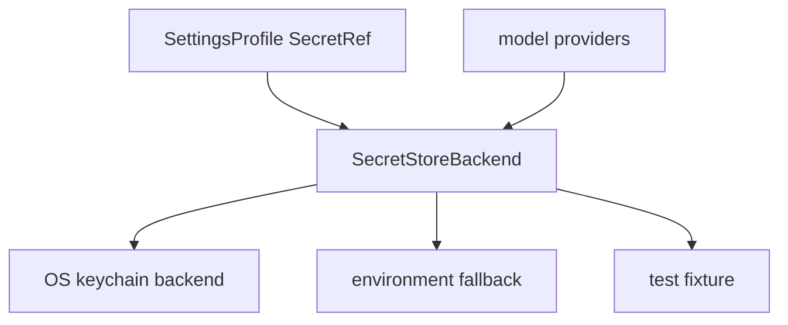

# M25-02 OS Keychain Secret Store Spec

## Purpose

Add a secret store abstraction with OS keychain support and environment fallback so settings and provider configuration can reference credentials without storing raw secret values.

## Product Context

M14 introduced secret references and runtime configuration. M25-02 makes secret handling production-grade for packaged CLI and Desktop installs.

## Scope

This spec delivers:

- `SecretStoreBackend` trait for get, put, delete, and diagnostics
- OS keychain adapter contracts for macOS, Linux, and Windows
- environment fallback resolver
- in-memory fixture backend for tests
- Desktop-safe secret write flow returning `SecretRef`
- redacted CLI diagnostics for secret store health

Owned by other specs:

- settings profile persistence: M25-01
- release packaging and signing: M25-04 and M25-05

## Architecture

`ruse-model` owns secret resolver and provider-facing secret contracts. OS-specific backends are selected by startup configuration. CLI and Desktop never receive raw secret values after write.



## Public Contracts

```rust
#[async_trait]
pub trait SecretStoreBackend: Send + Sync {
    async fn put(&self, name: &str, value: SecretValue) -> Result<SecretRef, SecretStoreError>;
    async fn get(&self, reference: &SecretRef) -> Result<SecretValue, SecretStoreError>;
    async fn delete(&self, reference: &SecretRef) -> Result<(), SecretStoreError>;
    async fn health(&self) -> SecretStoreHealth;
}

pub enum SecretStoreKind {
    OsKeychain,
    Environment,
    Memory,
}
```

## State and Failure Handling

- missing OS keychain support falls back to configured env resolution or reports a recoverable setup diagnostic
- failed writes do not update settings references
- delete is idempotent for missing references
- provider invocation fails before network calls if required secret resolution fails

## Security and Privacy

- raw secrets are wrapped in non-serializable types
- debug output redacts secret material
- CLI and Desktop only display reference names and health diagnostics
- tests assert logs and errors do not include raw values

## Testing Strategy

- in-memory backend unit tests for lifecycle operations
- env fallback tests for missing and present variables
- provider secret resolution tests before network invocation
- redaction tests for errors, debug output, and UI diagnostics
- OS keychain adapter tests behind platform fixtures or feature gates

## Acceptance Criteria

- model providers can resolve credentials through `SecretStoreBackend`
- settings persist `SecretRef`, never raw values
- focused tests pass with `cargo test -p ruse-model secret_store`

## Completion Signal

M25-02 is complete when secret references can be written, resolved, deleted, diagnosed, and used by providers without raw secret exposure.
