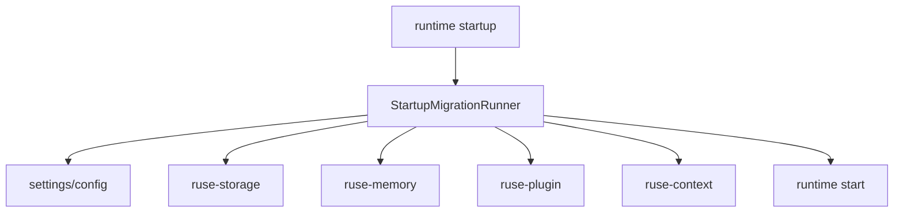

# M25-03 Startup Migrations Spec

## Purpose

Run idempotent startup migrations for settings, storage, memory, plugin manifests, and prompt profiles before runtime side effects begin.

## Product Context

Packaged installs must survive upgrades. M25-03 provides the startup safety layer that converts existing local state to the current schema or stops with recoverable diagnostics.

## Scope

This spec delivers:

- `StartupMigrationRunner` and `StartupMigrationPlan`
- per-domain migration participants for config, event storage, checkpoints, memory, plugins, and prompts
- backup or rollback requirement before mutating durable state
- migration audit events and diagnostics
- CLI startup check command and UI-safe migration status snapshot

Owned by other specs:

- path and settings locations: M25-01
- release artifact smoke tests: M25-04 and M25-05

## Architecture

`ruse-core` orchestrates startup migration. `ruse-storage`, `ruse-memory`, `ruse-plugin`, and `ruse-context` provide domain migration participants. Startup blocks runtime execution until the plan verifies successfully.



## Public Contracts

```rust
pub struct StartupMigrationPlan {
    pub from_versions: Vec<SchemaVersionRecord>,
    pub steps: Vec<StartupMigrationStep>,
    pub backup_required: bool,
}

pub trait StartupMigrationParticipant {
    fn domain(&self) -> &'static str;
    fn plan(&self) -> Result<Vec<StartupMigrationStep>, MigrationError>;
    fn apply(&self, step: &StartupMigrationStep) -> Result<(), MigrationError>;
    fn verify(&self) -> Result<(), MigrationError>;
}
```

## State and Failure Handling

- planning is side-effect free
- apply is idempotent and records completed steps
- failed verification stops startup before agent turns or background tasks run
- partial failures return recovery diagnostics with backup locations
- repeated startup after a completed migration is a no-op

## Security and Privacy

- migration logs redact secret-like values and memory content
- backups exclude raw secrets and can omit sensitive memory payloads
- plugin manifest migrations do not execute plugin code
- migration diagnostics are UI-safe by default

## Testing Strategy

- participant unit tests for idempotency
- integration test for ordered startup plan execution
- failure test proving runtime does not start after migration error
- audit serialization tests
- corrupted state fixture tests

## Acceptance Criteria

- startup can plan, apply, verify, and audit migrations across domains
- failed migrations are recoverable and block runtime side effects
- focused tests pass with `cargo test -p ruse-core startup_migrations`

## Completion Signal

M25-03 is complete when startup migrations are deterministic, idempotent, audited, and integrated before runtime startup.
