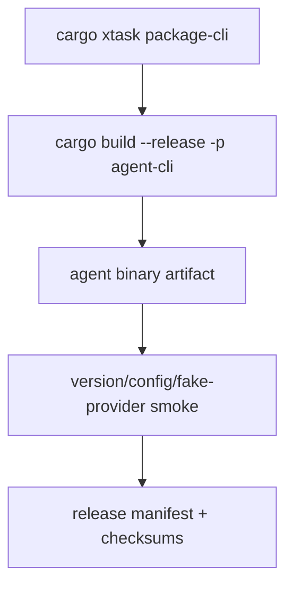

# M25-04 CLI Release Packaging Spec

## Purpose

Add repeatable CLI release artifact generation and smoke tests for the `agent` binary across local target platforms.

## Product Context

After paths, secrets, and migrations exist, M25-04 makes the CLI installable and verifiable as a release artifact rather than only a workspace command.

## Scope

This spec delivers:

- release profile and artifact naming conventions
- `xtask` packaging commands for CLI artifacts
- version, config path, settings, and fake-provider smoke tests
- local release manifest metadata for CLI artifacts
- checksum generation
- release checklist documentation

Owned by other specs:

- Desktop bundle packaging and updater metadata: M25-05
- hosted distribution and public signing service: later milestones

## Architecture

`xtask` owns release orchestration. `agent-cli` provides the `agent` binary and smoke-test commands. Packaging outputs are written under a deterministic target release directory.



## Public Contracts

```rust
pub struct CliReleaseArtifact {
    pub name: String,
    pub target_triple: String,
    pub version: String,
    pub path: PathBuf,
    pub checksum_sha256: String,
}

pub enum ReleaseChannel {
    Dev,
    Beta,
    Stable,
}
```

## State and Failure Handling

- packaging fails if the binary cannot print version information
- smoke tests run against a temporary config/data root
- failed packaging removes incomplete manifest files
- checksum generation is deterministic for completed artifacts

## Security and Privacy

- release logs redact environment secrets
- packaging does not embed local config or memory
- signing hooks reference external key material only
- smoke config uses fake providers by default

## Testing Strategy

- `xtask` command plan tests
- artifact metadata serialization tests
- smoke test fixture for version/config/fake prompt
- checksum tests on fixture artifacts
- release checklist validation

## Acceptance Criteria

- `cargo xtask package-cli` builds a local CLI artifact
- the artifact passes version, settings, and fake-provider smoke checks
- focused tests pass with `cargo test -p xtask package_cli`

## Completion Signal

M25-04 is complete when CLI packaging is repeatable, smoke-tested, and documented with artifact metadata and checksums.
