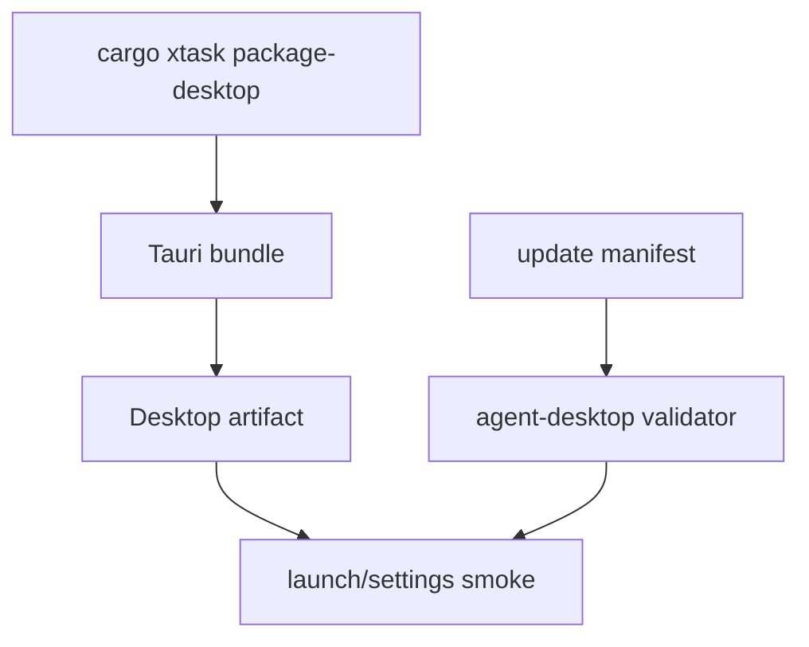

# M25-05 Desktop Bundle and Updater Spec

## Purpose

Add local Desktop bundle generation, update manifest handling, and smoke checks so the Desktop app can be packaged and verified alongside the CLI.

## Product Context

M21 provides a Desktop MVP. M25-05 prepares it for release workflows through Tauri bundle metadata, local update validation, settings startup checks, and failure-safe update behavior.

## Scope

This spec delivers:

- Tauri bundle metadata aligned with release channels
- Desktop package command through `xtask`
- local update manifest schema and validation
- Desktop smoke checks for launch metadata and settings diagnostics
- update failure behavior that preserves the current app
- release artifact checklist for Desktop

Owned by other specs:

- CLI release artifact generation: M25-04
- hosted update service and production signing: later milestones

## Architecture

`apps/desktop/src-tauri` owns Tauri bundle config. `xtask` orchestrates local bundle and smoke checks. `agent-desktop` exposes safe startup snapshots, settings diagnostics, and update manifest validation contracts.



## Public Contracts

```rust
pub struct UpdateManifest {
    pub channel: ReleaseChannel,
    pub version: String,
    pub artifacts: Vec<DesktopUpdateArtifact>,
}

pub struct DesktopUpdateArtifact {
    pub platform: String,
    pub url: String,
    pub checksum_sha256: String,
    pub signature: Option<String>,
}
```

## State and Failure Handling

- invalid manifests are rejected before update actions
- failed update checks leave current app state unchanged
- local smoke uses temporary config/data roots
- bundle failures do not overwrite previous successful artifacts

## Security and Privacy

- update metadata is validated before use
- signatures are optional in local dev but contract-compatible with production signing
- Desktop smoke logs redact secrets
- packaged app does not include local memory, config, or keychain values

## Testing Strategy

- update manifest validation tests
- Tauri config metadata tests where feasible
- `xtask` command plan tests for Desktop packaging
- Desktop startup snapshot smoke tests with temporary roots
- failure tests for invalid manifest and missing artifacts

## Acceptance Criteria

- `cargo xtask package-desktop` can build or plan a local Desktop bundle
- update manifests validate before use
- Desktop smoke checks confirm version/settings startup behavior
- focused tests pass with `cargo test -p agent-desktop update_manifest`

## Completion Signal

M25-05 and M25 are complete when Desktop packaging, update manifest validation, CLI/Desktop release smoke checks, and release documentation are complete.
