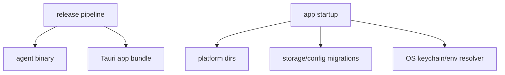

# M25 Packaging, Settings, and Updates Spec

## Purpose

Prepare `agent` for repeatable local distribution by adding production-grade packaging, settings management, migrations, release channels, signing hooks, and update flows for CLI and Desktop.

## Product Context

Earlier milestones build runtime and product capabilities. A serious tool comparable to Claude Code or Codex Desktop needs installable binaries, stable config directories, secret storage, Desktop bundles, updater flow, migration safety, and release verification.

## Scope

This milestone delivers:

- CLI binary packaging for macOS, Linux, and Windows
- Desktop bundle packaging through Tauri
- stable config, data, cache, log, and plugin directory resolution
- OS keychain secret store integration with env fallback
- settings commands and Desktop/TUI settings views
- schema/config migration runner for startup and upgrade
- release channel metadata and updater hooks
- release verification checklist and artifact smoke tests

Owned by later milestones:

- hosted account sync
- enterprise policy distribution
- public plugin marketplace signing service

## Architecture

`ruse-cli` exposes the `agent` binary. `ruse-desktop` and the Tauri app package the GUI. `ruse-core` loads migrated runtime config. `ruse-storage` and `ruse-memory` run schema migrations. `ruse-model` owns secret resolver contracts and OS keychain adapters.

## Key Contracts

- `PlatformPaths`
- `SettingsProfile`
- `SettingsMutation`
- `StartupMigrationPlan`
- `SecretStoreBackend`
- `ReleaseChannel`
- `UpdateManifest`
- `ArtifactSmokeTest`

Contract rules:

- local `config.yaml` may store direct provider `apiKey` values for setup convenience, but release artifacts, migrations, logs, snapshots, and support exports must redact them; advanced secret references remain supported
- migrations are versioned, idempotent, and audited
- CLI and Desktop use the same platform path resolver
- release artifacts are verified before publish

## State and Failure Handling

- failed migrations stop startup before runtime side effects
- partial migration writes rollback or require explicit recovery
- missing keychain support falls back to env or prompts according to surface
- update failure leaves the current version usable
- corrupted settings files produce diagnostics and safe defaults

## Security and Privacy

- signing keys are never part of repository config
- release logs redact secrets and tokens
- update metadata is verified before use
- settings export can omit secrets and sensitive memory by default

## Testing Strategy

- platform path tests for macOS, Linux, and Windows expectations
- migration idempotency tests
- settings mutation and redaction tests
- keychain adapter fixture tests with env fallback
- release artifact smoke tests for CLI and Desktop bundles

## Acceptance Criteria

- Users can install and run `agent` from a packaged CLI binary.
- Desktop can be built as a local app bundle.
- Settings and secrets survive upgrade without raw secret exposure.
- Migration failures are recoverable and auditable.

## Completion Signal

M25 is complete when release artifacts can be built, smoke-tested, and upgraded through documented local release channels.
