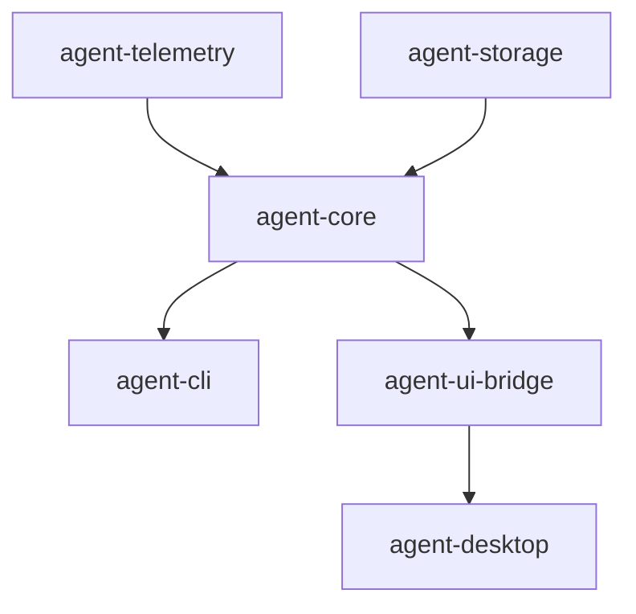

# M26-00 Runtime Observability Technical Design Spec

## Purpose

Define the M26 architecture baseline for turning runtime traces, audit exports, telemetry records, and replay metadata into one evidence layer.

## Product Context

Agent users need to answer what happened, why it happened, which permissions were used, whether replay is possible, and what can be shared for debugging. This technical design keeps those answers typed, redacted, and reusable across CLI and Desktop.

## Scope

This spec delivers:

- evidence ownership boundaries across telemetry, core, storage, CLI, and UI bridge crates
- correlation rules for conversation, turn, task, trace, span, event, and audit identifiers
- privacy rules for exported telemetry, audit summaries, and replay diagnostics
- M26 slice breakdown and verification gates

Owned by other specs:

- concrete telemetry export structs: `M26-01`
- core evidence bundle implementation: `M26-02`
- CLI commands: `M26-03`
- UI snapshots: `M26-04`
- replay verification: `M26-05`

## Architecture

`agent-telemetry` remains independent from `agent-core` and owns telemetry export shape. `agent-core` composes evidence by reading runtime events, building trace entries, exporting audit records, accepting telemetry records, and deriving replay summaries. UI crates receive only bounded snapshots.



## Public Contracts

```rust
pub struct ReplayEvidenceSummary {
    pub replayable: bool,
    pub event_count: usize,
    pub checkpoint_count: usize,
    pub diagnostics: Vec<String>,
}

pub struct ObservabilityEvidenceOptions {
    pub include_trace: bool,
    pub include_audit: bool,
    pub include_telemetry: bool,
    pub include_replay: bool,
    pub max_payload_bytes: usize,
}
```

## State and Failure Handling

- evidence generation is read-only and has no tool/model side effects
- empty event stores produce valid empty evidence bundles
- invalid option values fail before evidence generation starts
- unsupported replay fixtures produce diagnostics in verification commands, not partial false positives
- all evidence generation functions are deterministic for fixed inputs and generated timestamp

## Security and Privacy

- telemetry and audit redaction must run before evidence reaches CLI or Desktop
- bundle summaries do not include raw prompts, raw file contents, or raw secret values
- exported JSON includes schema versions for migration and compatibility checks
- evidence generated from plugins/MCP includes source identifiers, not untrusted raw payloads

## Testing Strategy

- unit tests for option validation and correlation summaries
- integration tests for local coding fixture evidence
- snapshot-style serde tests for evidence bundle shape
- replay fixture tests for old trace compatibility
- CLI/Desktop tests asserting no raw secret leakage

## Acceptance Criteria

- Technical design defines crate ownership, privacy rules, and slice order.
- M26 milestone and slice indexes are present in `docs/milestones/README.md`.
- M26-01 can start with clear contracts and verification commands.

## Completion Signal

M26-00 is complete when this design, the M26 milestone plan, slice specs, and slice plans are committed.
