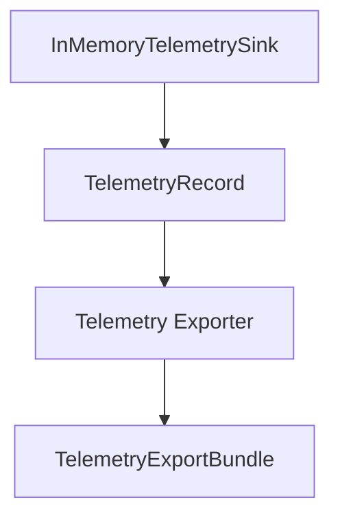

# M26-01 Telemetry Export Bundles Spec

## Purpose

Add a stable telemetry export bundle contract that turns spans and metrics into redacted, bounded, filterable records for evidence packages.

## Product Context

Telemetry already records provider-neutral spans and metrics in memory. M26 needs those records to be portable, safe to show in CLI/Desktop, and suitable for later evidence bundle composition.

## Scope

This spec delivers:

- `TelemetryExportBundle`
- `TelemetryExportRecord`
- `TelemetryExportSummary`
- `TelemetryExportOptions`
- export functions with deterministic ordering and generated timestamp injection
- filtering, redaction, truncation diagnostics, and option validation

Owned by other specs:

- runtime event/audit/replay composition: `M26-02`
- CLI commands: `M26-03`
- UI snapshots: `M26-04`

## Architecture

Telemetry export lives entirely in `ruse-telemetry`. It may depend on `ruse-types::Timestamp`, but it must not depend on `ruse-core`, storage, CLI, Desktop, models, plugins, MCP, or UI bridge crates.



## File Layout

```text
crates/
  ruse-telemetry/
    src/
      export.rs
      lib.rs
    tests/
      telemetry_export.rs
```

## Public Contracts

```rust
pub struct TelemetryExportOptions {
    pub include_spans: bool,
    pub include_metrics: bool,
    pub max_attribute_value_bytes: usize,
}

pub fn export_telemetry_bundle(
    records: &[TelemetryRecord],
    options: TelemetryExportOptions,
) -> Result<TelemetryExportBundle, TelemetryError>;
```

## State and Failure Handling

- input record order is preserved through exported `index`
- empty input produces a valid empty bundle
- disabling both spans and metrics is rejected
- zero attribute budget is rejected
- attribute values longer than the budget are truncated and counted in diagnostics
- redaction is applied before truncation and export

## Security and Privacy

- secret-like telemetry keys and values export as `[redacted]`
- exported records never expose raw values that the telemetry sink would redact
- filtering does not mutate source telemetry records
- diagnostics describe truncation and filtering, not raw secret content

## Testing Strategy

- stable serde shape for a span and metric bundle
- span/metric filtering
- redaction and truncation diagnostics
- invalid options
- empty record list

## Acceptance Criteria

- `ruse-telemetry` exports bundle contracts from `lib.rs`.
- `cargo test -p ruse-telemetry telemetry_export` passes.
- M26-01 status is marked complete in the milestone docs after implementation.

## Completion Signal

M26-01 is complete when telemetry export tests pass, focused clippy passes for `ruse-telemetry`, docs status is updated, and the slice is committed.
