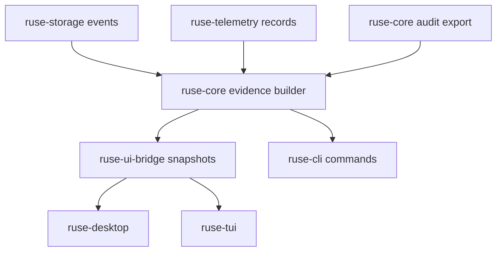

# M26 Runtime Observability Evidence Spec

## Purpose

Turn existing traces, telemetry, audit exports, and replay records into one durable observability evidence layer that CLI, TUI, Desktop, background agents, plugins, and support workflows can inspect without exposing secrets.

## Product Context

The PRD requires every meaningful runtime action to be observable, auditable, and replayable. Earlier milestones introduced event sourcing, trace queries, audit exports, telemetry contracts, task traces, and Desktop timelines. M26 connects those pieces into stable evidence contracts and user-facing export/debug surfaces.

## Scope

This milestone delivers:

- telemetry export bundles with redaction, filtering, bounded attributes, and summaries
- runtime observation records that correlate events, spans, metrics, audit records, and replay checkpoints
- observability evidence bundles for support/debug workflows
- CLI commands for trace export, audit export, telemetry summary, and replay-safe evidence inspection
- UI bridge/Desktop-safe evidence snapshots

Owned by other milestones:

- raw event persistence and replay compatibility: M01-M04
- audit export basics and telemetry primitives: M12
- runtime turn, tool, approval, task, memory, plugin, and Desktop behavior: M13-M25

## Architecture

`ruse-telemetry` owns provider-neutral telemetry export contracts. `ruse-core` composes runtime events, telemetry records, audit records, and replay metadata into evidence bundles. `ruse-cli`, `ruse-tui`, `ruse-desktop`, and `ruse-ui-bridge` render typed summaries only.



## File Layout

```text
crates/
  ruse-telemetry/
    src/export.rs
    tests/telemetry_export.rs
  ruse-core/
    src/observability.rs
    tests/observability_evidence.rs
  ruse-cli/
    tests/observability_commands.rs
  ruse-ui-bridge/
    tests/observability_snapshot.rs
docs/
  specs/M26-*.spec.md
  plans/M26-*.plan.md
```

## Public Contracts

```rust
pub struct TelemetryExportBundle {
    pub schema_version: u32,
    pub generated_at: Timestamp,
    pub records: Vec<TelemetryExportRecord>,
    pub summary: TelemetryExportSummary,
}

pub struct ObservabilityEvidenceBundle {
    pub schema_version: u32,
    pub generated_at: Timestamp,
    pub trace: Vec<TraceEntry>,
    pub audit: AuditExportBundle,
    pub telemetry: TelemetryExportBundle,
    pub replay: ReplayEvidenceSummary,
}
```

## State and Failure Handling

- export builders validate options before reading or serializing records
- bundle generation is read-only and idempotent for the same inputs and timestamp
- unknown event types remain visible as typed summaries instead of being dropped
- oversized attribute values are truncated with diagnostics
- missing telemetry records still produce a valid empty telemetry bundle
- replay metadata records whether evidence is replayable, partially replayable, or unavailable

## Security and Privacy

- raw prompts, raw secrets, and raw environment values are not exported
- secret-like telemetry attributes and audit summaries are redacted before storage in bundles
- CLI/Desktop render evidence summaries by default and require explicit export flags for JSON bundles
- plugin, MCP, and tool metadata stay scoped to declared capability/resource identifiers

## Testing Strategy

- `ruse-telemetry` unit tests cover stable bundle serde, filtering, redaction, truncation, and option validation
- `ruse-core` tests cover cross-source evidence correlation and replay summaries
- CLI tests cover text and JSON outputs with no raw secret leakage
- UI bridge/Desktop tests cover bounded snapshots and stable frame schemas
- replay tests prove evidence can be regenerated from stored events without mutating runtime state

## Acceptance Criteria

- M26 slice specs and plans exist for telemetry export, runtime evidence, CLI debug/export, UI snapshots, and replay verification.
- Each completed slice ships source, tests, docs status updates, and a git commit.
- `cargo xtask check` passes before M26 is marked complete.

## Completion Signal

M26 is complete when all M26 slice implementation rows are complete in `docs/milestones/README.md`, observability evidence can be exported through CLI and UI-safe contracts, and workspace checks pass.
