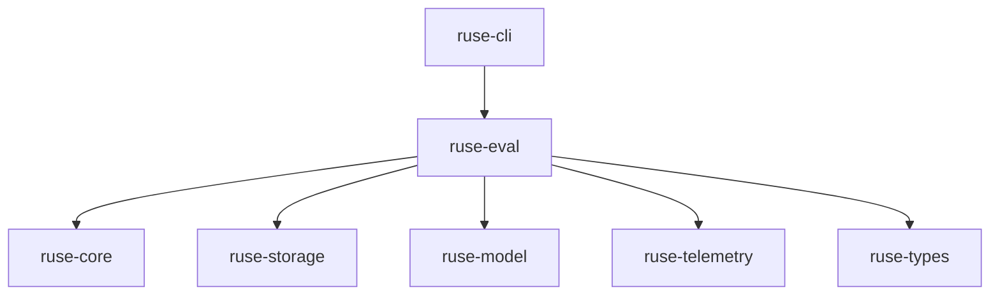

# M27-00 Runtime Evaluation Technical Design Spec

## Purpose

Define the evaluation harness architecture before implementation so every M27 slice can add durable contracts without turning CLI tests, replay tests, and evidence checks into disconnected one-off fixtures.

## Product Context

M27 follows M26 observability evidence. The runtime now needs a way to continuously prove that event sourcing, replay, tools, policy, memory, prompts, background tasks, plugins, and UI-safe projections do not regress as implementation expands.

## Scope

This spec delivers:

- evaluation crate ownership and dependency direction
- scenario kind taxonomy and fixture rules
- deterministic execution and isolation policy
- golden comparison and report strategy
- CLI/CI integration boundaries

Owned by other specs:

- concrete manifest structs and validation: M27-01
- executable runner behavior: M27-02
- golden comparison implementation: M27-03
- user-facing CLI commands: M27-04
- CI artifact generation: M27-05

## Architecture

`ruse-eval` is a runtime-adjacent crate. It can depend on core runtime contracts, storage replay, telemetry/evidence contracts, and model fixtures. It must not depend on CLI, TUI, Desktop, or app crates.



## File Layout

```text
crates/
  ruse-eval/
    Cargo.toml
    src/
      lib.rs
      manifest.rs
      runner.rs
      golden.rs
      report.rs
docs/
  specs/M27-00-runtime-evaluation-technical-design.spec.md
  plans/M27-00-runtime-evaluation-technical-design.plan.md
```

## Public Contracts

```rust
pub enum EvalScenarioKind {
    ReplayTrace,
    FakeModelTurn,
    LocalCoding,
    EvidenceOnly,
}

pub enum EvalStrictness {
    Strict,
    Warn,
}

pub enum EvalScenarioStatus {
    Passed,
    Failed,
    Skipped,
    Invalid,
    NotRun,
}
```

## State and Failure Handling

- validation happens before runner setup
- each scenario produces exactly one terminal status
- strict runs fail on invalid manifests, unsupported scenario kinds, or golden mismatches
- warn runs continue and record diagnostics
- scenario execution is isolated from other scenarios through explicit fixture roots and temp workspaces

## Security and Privacy

- manifests are untrusted input and must reject path traversal outside declared roots
- scenarios declare side-effect needs before execution
- reports contain bounded values and redacted diagnostics
- live network/model calls are out of scope for M27 unless a scenario explicitly opts into a future capability

## Testing Strategy

- architecture is tested through crate dependency direction and compile-time imports
- manifest and report contracts have stable serde tests
- runner and golden behavior use deterministic fixtures
- CLI/CI tests prove user-facing output is derived from `ruse-eval`

## Acceptance Criteria

- the M27 slice decomposition exists and points to one `ruse-eval` owner crate
- `docs/milestones/README.md` records M27 as the active milestone
- every later M27 slice has a spec and plan with verification commands

## Completion Signal

This technical design is complete when M27 is decomposed into implementation slices and the milestone index names `ruse-eval` as the shared evaluation harness owner.
