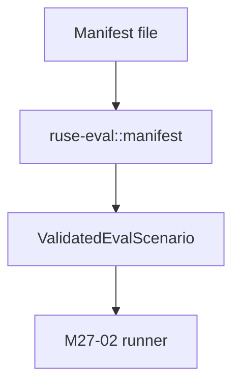

# M27-01 Scenario Manifest Contracts Spec

## Purpose

Add versioned, typed scenario manifests so runtime regression tests can be described as durable data rather than ad hoc test code.

## Product Context

Evaluation scenarios are the entry point for M27. They describe which fixture to run, which capabilities are allowed, which evidence to collect, and which expectations must hold.

## Scope

This spec delivers:

- `ruse-eval` crate scaffold
- versioned manifest structs and enums
- manifest validation and path normalization
- serde stability tests
- fixture root and side-effect declaration rules

Owned by other specs:

- executing scenarios: M27-02
- comparing actual results with goldens: M27-03
- CLI command surfaces: M27-04
- CI artifacts: M27-05

## Architecture

`ruse-eval::manifest` owns all manifest parsing and validation. It depends only on shared typed crates needed for IDs and timestamps. Runner-specific code consumes validated manifests.



## File Layout

```text
crates/
  ruse-eval/
    Cargo.toml
    src/
      lib.rs
      manifest.rs
    tests/
      manifest.rs
Cargo.toml
```

## Public Contracts

```rust
pub struct EvalScenarioManifest {
    pub schema_version: u32,
    pub id: String,
    pub name: String,
    pub kind: EvalScenarioKind,
    pub fixtures: EvalFixtures,
    pub permissions: EvalPermissionProfile,
    pub expectations: EvalExpectations,
}

pub struct ValidatedEvalScenario {
    pub manifest: EvalScenarioManifest,
    pub normalized_fixture_root: Utf8PathBuf,
    pub diagnostics: Vec<EvalDiagnostic>,
}
```

## State and Failure Handling

- schema versions other than the supported version fail validation
- scenario IDs must be stable slug identifiers
- fixture paths are normalized relative to a caller-provided root
- path traversal, absolute paths outside the fixture root, and missing required fixture fields are invalid
- unknown scenario kinds or expectation fields fail serde deserialization

## Security and Privacy

- manifests are treated as untrusted input
- environment variables are declared by key only, not by value
- side-effect capabilities default to none
- secret-like metadata keys are rejected or redacted in diagnostics

## Testing Strategy

- serde round-trip test for a complete valid manifest
- validation tests for bad schema version, invalid ID, missing fixture, and path traversal
- default permission tests prove scenarios start read-only/offline
- diagnostics tests prove secrets are not echoed

## Acceptance Criteria

- `ruse-eval` exists in the workspace.
- manifest contracts are public, serializable, and covered by tests.
- invalid manifests fail before runner code can execute side effects.
- `cargo test -p ruse-eval manifest` passes.

## Completion Signal

M27-01 is complete when `ruse-eval::manifest` can parse and validate versioned scenario manifests with stable serde behavior and focused tests pass.
