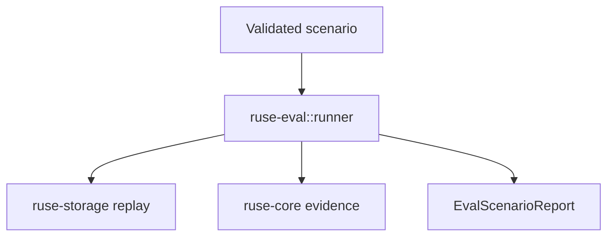

# M27-02 Scenario Runner Core Spec

## Purpose

Execute validated evaluation scenarios through deterministic runtime paths and produce typed scenario reports.

## Product Context

After M27-01 defines scenario manifests, M27-02 makes them useful by running replay, fake-model, local-coding, and evidence-only scenarios without embedding evaluation behavior in CLI tests.

## Scope

This spec delivers:

- runner options and execution result contracts
- replay-trace scenario execution
- evidence-only scenario execution over existing bundles or fixtures
- fake-model/local-coding runner hooks with deterministic fixture inputs
- cancellation/interruption status mapping

Owned by other specs:

- manifest validation: M27-01
- golden comparison: M27-03
- CLI commands: M27-04
- CI artifact generation: M27-05

## Architecture

`ruse-eval::runner` consumes `ValidatedEvalScenario` and writes `EvalScenarioReport`. It calls existing runtime/replay/evidence builders and never performs direct user-facing rendering.



## File Layout

```text
crates/
  ruse-eval/
    src/
      runner.rs
      report.rs
    tests/
      runner.rs
```

## Public Contracts

```rust
pub struct EvalRunnerOptions {
    pub strictness: EvalStrictness,
    pub max_scenarios: Option<usize>,
}

pub struct EvalScenarioReport {
    pub scenario_id: String,
    pub status: EvalScenarioStatus,
    pub diagnostics: Vec<EvalDiagnostic>,
    pub evidence_summary: Option<EvalEvidenceSummary>,
}
```

## State and Failure Handling

- every validated scenario reaches exactly one terminal status
- unsupported scenario kinds become `Invalid` in strict mode and `Skipped` in warn mode
- fixture read errors produce `Failed` with bounded diagnostics
- interruptions preserve already completed scenario reports

## Security and Privacy

- runner executes only declared fixture paths and side-effect capabilities
- local-coding scenarios use temp workspaces and existing policy paths
- reports include summaries and redacted diagnostics, not raw secrets

## Testing Strategy

- replay fixture scenario produces a passed report
- evidence-only scenario produces a passed report with evidence counts
- invalid/unsupported scenario behavior differs by strictness
- interrupted run preserves completed reports and marks pending scenarios

## Acceptance Criteria

- runner can execute at least replay-trace and evidence-only scenarios.
- report structs are serializable and deterministic.
- `cargo test -p ruse-eval runner` passes.

## Completion Signal

M27-02 is complete when validated manifests can be executed into typed scenario reports without CLI-specific code.
