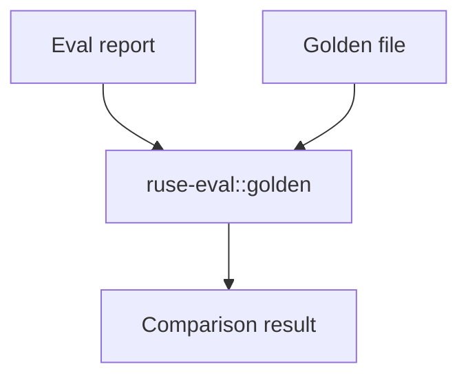

# M27-03 Golden Evidence Comparison Spec

## Purpose

Compare actual evaluation reports and observability evidence against checked-in golden expectations with stable, redacted mismatch diagnostics.

## Product Context

Regression scenarios are only useful when failures explain what changed. M27-03 turns runner output into actionable comparisons that can be used locally and in CI.

## Scope

This spec delivers:

- golden file schema and selector rules
- deterministic comparison engine
- mismatch diagnostics with JSON pointer paths
- redaction and output bounding
- update-mode contract for future CLI support

Owned by other specs:

- scenario execution: M27-02
- CLI flags for compare/update: M27-04
- CI artifact layout: M27-05

## Architecture

`ruse-eval::golden` compares selected fields from `EvalScenarioReport` and evidence summaries. It does not know about CLI formatting.



## File Layout

```text
crates/
  ruse-eval/
    src/golden.rs
    tests/golden.rs
```

## Public Contracts

```rust
pub struct GoldenComparisonResult {
    pub status: EvalScenarioStatus,
    pub mismatches: Vec<GoldenMismatch>,
}

pub struct GoldenMismatch {
    pub path: String,
    pub expected: String,
    pub actual: String,
}
```

## State and Failure Handling

- missing golden files produce a failed comparison unless update mode is enabled
- unexpected additional fields are ignored unless selected by the golden schema
- value mismatches use bounded strings
- malformed goldens fail before scenario status is marked passed

## Security and Privacy

- mismatch values are redacted through the same secret key/value rules as evidence exports
- raw prompts and raw tool output can be compared only through summaries or explicit safe fields
- large values are truncated with diagnostics

## Testing Strategy

- exact match passes
- scalar mismatch reports a stable path
- missing/extra selected field behavior is deterministic
- secret-like values are redacted
- update mode writes or returns normalized expected output through a typed contract

## Acceptance Criteria

- actual reports can be compared against golden expectations.
- mismatch diagnostics are stable and redacted.
- `cargo test -p ruse-eval golden` passes.

## Completion Signal

M27-03 is complete when eval scenarios can produce pass/fail comparison results suitable for CLI and CI.
