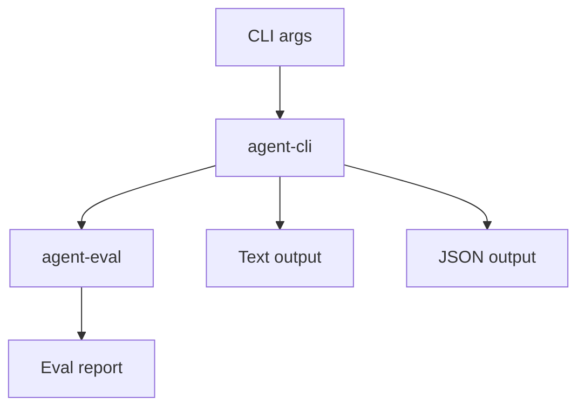

# M27-04 CLI Eval Commands Spec

## Purpose

Expose evaluation scenarios through scriptable CLI commands without moving evaluation logic into the CLI crate.

## Product Context

Developers need a fast local way to list, validate, run, and inspect regression scenarios. CI needs the same behavior in JSON with stable exit codes.

## Scope

This spec delivers:

- `agent-cli eval list`
- `agent-cli eval validate`
- `agent-cli eval run`
- text and JSON output modes
- pass/fail/invalid exit-code semantics

Owned by other specs:

- manifest parsing and validation: M27-01
- scenario execution: M27-02
- golden comparison: M27-03
- CI artifact layout: M27-05

## Architecture

`agent-cli` parses command arguments and delegates to `agent-eval`. Output formatting uses existing CLI output patterns.



## File Layout

```text
crates/
  agent-cli/
    src/
      command.rs
      output.rs
    tests/
      eval_commands.rs
```

## Public Contracts

```text
agent-cli eval list --manifest <path> [--json]
agent-cli eval validate --manifest <path> [--json]
agent-cli eval run --manifest <path> [--json] [--strict|--warn]
```

## State and Failure Handling

- validation errors exit non-zero and print bounded diagnostics
- failed scenarios exit non-zero in strict mode
- skipped scenarios are visible in output
- JSON output is parseable for every terminal outcome

## Security and Privacy

- CLI never prints raw secret values from manifests or reports
- JSON mode emits typed report data only
- local-coding scenarios require declared capabilities and later policy controls

## Testing Strategy

- list command shows scenario IDs
- validate command passes valid manifests and fails invalid manifests
- run command emits text and JSON reports
- exit-code tests cover passed, failed, invalid, and warn/skipped cases

## Acceptance Criteria

- CLI eval commands call `agent-eval` contracts.
- text and JSON output are deterministic and redacted.
- `cargo test -p agent-cli eval_commands` passes.

## Completion Signal

M27-04 is complete when developers can run evaluation scenarios from the CLI and CI can consume JSON output.
