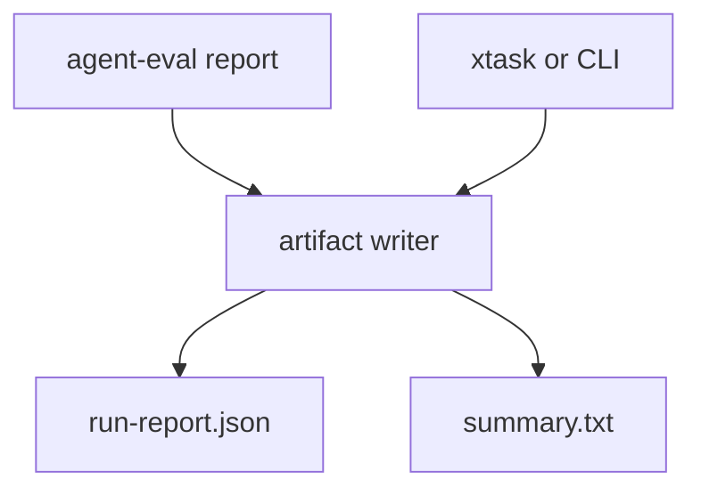

# M27-05 CI Reporting Integration Spec

## Purpose

Produce stable evaluation artifacts that can be archived by CI, inspected locally, and compared across runtime changes.

## Product Context

M27 should end with an evaluation loop that developers can run before merging changes. CI/reporting integration makes scenario results durable, easy to review, and useful for regression triage.

## Scope

This spec delivers:

- machine-readable run report artifact
- compact text summary artifact
- deterministic artifact naming
- `xtask` integration or documented CI command
- README/milestone status updates

Owned by other specs:

- manifest, runner, golden comparison, and CLI command internals: M27-01 through M27-04
- hosted CI provider configuration: future repository infrastructure

## Architecture

`agent-eval` owns report structures and artifact writers. CLI/xtask invoke the writer with output directories. CI consumes generated files.



## File Layout

```text
crates/
  agent-eval/
    src/report.rs
    tests/report.rs
xtask/
  src/main.rs
README.md
docs/milestones/README.md
```

## Public Contracts

```rust
pub struct EvalArtifactOptions {
    pub output_dir: Utf8PathBuf,
    pub write_json: bool,
    pub write_summary: bool,
}

pub struct EvalArtifactSet {
    pub json_report: Option<Utf8PathBuf>,
    pub summary_report: Option<Utf8PathBuf>,
}
```

## State and Failure Handling

- artifact writes are atomic where practical
- existing files are overwritten only for the same deterministic artifact name
- failed writes do not change scenario statuses
- empty runs produce valid reports with zero scenarios

## Security and Privacy

- artifacts use redacted report data
- output directory traversal is rejected
- file names do not include prompts, secrets, or user-provided free-form text

## Testing Strategy

- artifact writer creates JSON and summary files
- JSON report round-trips through serde
- summary contains counts and failure IDs
- path validation rejects unsafe output paths
- final `cargo xtask check` passes before M27 completion

## Acceptance Criteria

- eval reports can be written as CI-friendly artifacts.
- README documents the eval workflow.
- M27 is marked complete only after workspace checks pass.

## Completion Signal

M27-05 and M27 are complete when evaluation artifacts are generated, documented, checked, and committed with milestone status updated.
