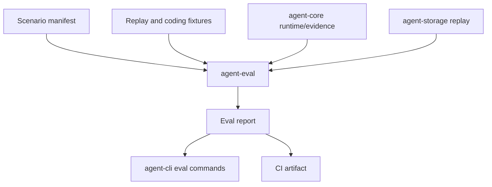

# M27 Runtime Evaluation Harness Spec

## Purpose

Turn deterministic traces, fake model turns, local coding fixtures, and observability evidence into a reusable evaluation harness that catches runtime regressions before they reach CLI, TUI, Desktop, or background-agent users.

## Product Context

The PRD requires long-term runtime evolution to remain auditable, replayable, and recoverable. M26 made evidence bundles available. M27 makes those bundles executable as scenarios with expected outcomes, golden evidence comparisons, and CI-friendly reports.

## Scope

This milestone delivers:

- versioned evaluation scenario manifests
- a scenario runner that can execute replay, fake-model, local-coding, and evidence-only scenarios
- stable golden output and evidence comparison contracts
- CLI commands for listing, validating, running, and reporting evaluations
- CI/report artifacts with deterministic pass/fail diagnostics

Owned by other milestones:

- raw runtime execution, replay, telemetry, and observability evidence: M01-M26
- live provider quality evaluation, model grading, and benchmark dashboards: future milestones

## Architecture

`agent-eval` owns evaluation manifests, runner contracts, comparison logic, and reports. It depends on typed runtime crates and stays independent from CLI/Desktop rendering. `agent-cli` exposes commands that call `agent-eval`. UI bridge support remains report-summary based unless a later milestone adds Desktop evaluation screens.



## File Layout

```text
crates/
  agent-eval/
    src/
      lib.rs
      manifest.rs
      runner.rs
      golden.rs
      report.rs
    tests/
      manifest.rs
      runner.rs
      golden.rs
      report.rs
  agent-cli/
    tests/
      eval_commands.rs
docs/
  specs/M27-*.spec.md
  plans/M27-*.plan.md
```

## Public Contracts

```rust
pub struct EvalScenarioManifest {
    pub schema_version: u32,
    pub id: String,
    pub kind: EvalScenarioKind,
    pub inputs: EvalScenarioInputs,
    pub expectations: EvalExpectations,
}

pub struct EvalRunReport {
    pub schema_version: u32,
    pub run_id: String,
    pub scenarios: Vec<EvalScenarioReport>,
    pub summary: EvalRunSummary,
}
```

## State and Failure Handling

- manifest validation fails before runtime side effects are attempted
- runner output is deterministic for the same scenario, fixture, and runtime version
- comparison failures include bounded, redacted diagnostics and stable mismatch paths
- unsupported scenario kinds are reported as skipped or invalid according to strictness options
- interrupted runs keep completed scenario reports and mark remaining scenarios as not run

## Security and Privacy

- scenario manifests declare every fixture, command, environment key, network need, and write target
- default evaluation mode uses fake providers, replay fixtures, and isolated temp workspaces
- reports never include raw secrets, raw prompt bodies marked sensitive, or unbounded tool output
- local-coding scenarios run through existing policy/sandbox paths and can require explicit opt-in

## Testing Strategy

- manifest tests cover serde stability, validation, path normalization, and unknown-field rejection
- runner tests cover deterministic replay/evidence scenarios and interrupted result handling
- golden tests cover pass, mismatch, missing-field, extra-field, and redaction behavior
- CLI tests cover text/JSON output and exit-code semantics
- CI/report tests cover artifact structure and stable summaries

## Acceptance Criteria

- M27 slice specs and plans exist for technical design, manifest contracts, runner core, golden comparison, CLI commands, and CI/report integration.
- Each completed slice ships source, tests, docs status updates, and a git commit.
- `cargo xtask check` passes before M27 is marked complete.

## Completion Signal

M27 is complete when scenario manifests can be validated, deterministic scenarios can be run, evidence/golden comparisons produce stable reports, CLI commands expose the workflow, CI artifacts are generated, all M27 rows are complete in `docs/milestones/README.md`, and workspace checks pass.
