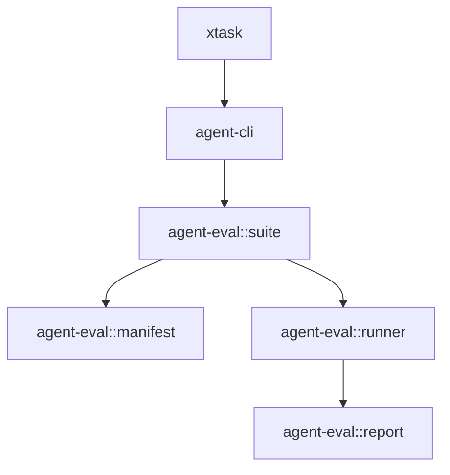

# M28-00 Evaluation Corpus Technical Design Spec

## Purpose

Define how evaluation suites, checked-in corpora, golden updates, CLI commands, and CI gates build on M27 without duplicating runner logic or leaking evaluation behavior into UI layers.

## Product Context

The runtime now has single-scenario evaluation. Long-term quality needs named suites, repeatable corpus layout, deliberate golden updates, and one command suitable for local development and CI.

## Scope

This spec delivers:

- scenario suite ownership in `agent-eval`
- corpus file layout and fixture resolution rules
- golden update separation from normal run mode
- CLI and `xtask` integration boundaries
- privacy and verification requirements

Owned by other specs:

- suite manifest implementation: M28-01
- built-in corpus files: M28-02
- golden update engine: M28-03
- CLI suite commands: M28-04
- `xtask` gate: M28-05

## Architecture

`agent-eval::suite` validates suite manifests and expands them into validated M27 scenarios. It may call M27 manifest validation but must not run CLI commands. `agent-cli` renders suite results. `xtask` plans or invokes CLI commands.



## File Layout

```text
crates/
  agent-eval/
    src/suite.rs
    tests/suite.rs
docs/
  eval/
    default.suite.json
```

## Public Contracts

```rust
pub enum EvalSuiteStrictness {
    Strict,
    Warn,
}

pub struct EvalSuiteManifest {
    pub schema_version: u32,
    pub id: String,
    pub scenarios: Vec<EvalSuiteScenarioRef>,
}
```

## State and Failure Handling

- suite validation is read-only
- duplicate suite scenario IDs fail validation
- unsafe scenario paths fail before scenario files are read
- scenario validation errors are returned with suite context
- missing files produce bounded diagnostics

## Security and Privacy

- suite manifests are untrusted
- paths resolve relative to a suite root and cannot use `..`
- suite labels and metadata are safe strings only
- reports reuse M27 redaction behavior

## Testing Strategy

- compile-time dependency direction through crate imports
- suite serde stability tests
- duplicate and path traversal validation tests
- scenario expansion tests using temp fixtures

## Acceptance Criteria

- M28 has milestone-level and slice-level docs.
- `docs/milestones/README.md` records M28 as active.
- implementation begins with M28-01.

## Completion Signal

The technical design is complete when M28 is decomposed and the milestone index points to M28-01 as the next implementation slice.
