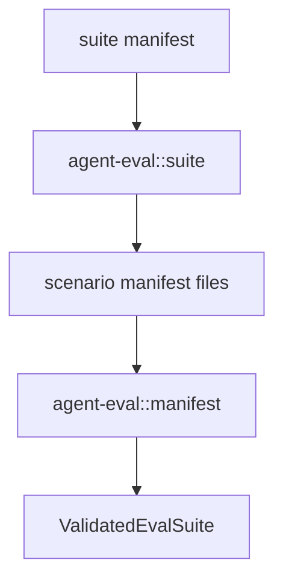

# M28-01 Scenario Suite Manifest Spec

## Purpose

Add versioned scenario suite manifests so many M27 scenarios can be grouped, validated, filtered, and run as one regression unit.

## Product Context

M27 can run one scenario manifest. M28 needs stable suite files for local developers and CI to run meaningful collections without hand-maintaining command lists.

## Scope

This spec delivers:

- `agent-eval::suite` module
- versioned `EvalSuiteManifest` and `EvalSuiteScenarioRef`
- safe scenario path resolution relative to suite root
- duplicate ID, label, and strictness validation
- loading referenced scenario manifests into `ValidatedEvalScenario`

Owned by other specs:

- built-in corpus files: M28-02
- golden update behavior: M28-03
- CLI suite commands: M28-04
- `xtask` gate: M28-05

## Architecture

`agent-eval::suite` depends on `agent-eval::manifest` and returns validated M27 scenarios. It is filesystem-aware but read-only.



## File Layout

```text
crates/
  agent-eval/
    src/suite.rs
    tests/suite.rs
```

## Public Contracts

```rust
pub const EVAL_SUITE_SCHEMA_VERSION: u32 = 1;

pub struct EvalSuiteManifest {
    pub schema_version: u32,
    pub id: String,
    pub name: String,
    pub scenarios: Vec<EvalSuiteScenarioRef>,
}

pub struct ValidatedEvalSuite {
    pub manifest: EvalSuiteManifest,
    pub scenarios: Vec<ValidatedEvalScenario>,
}
```

## State and Failure Handling

- unsupported schema versions fail
- suite IDs follow the same stable slug rules as scenario IDs
- scenario refs cannot be empty, absolute outside the suite root, or contain parent traversal
- duplicate scenario aliases fail
- missing scenario files and scenario validation errors include suite context

## Security and Privacy

- suite paths are untrusted
- labels are identifiers only and cannot contain secret-like values
- diagnostics redact secret-like path fragments and metadata
- suite loading does not execute scenarios

## Testing Strategy

- serde round-trip for valid suite
- validation for schema, ID, duplicate aliases, missing scenario files, and traversal
- expansion test loads two referenced scenario manifests from a temp suite root
- default strictness test proves predictable runner options

## Acceptance Criteria

- `agent-eval::suite` exposes typed suite contracts.
- focused suite tests pass.
- `docs/milestones/README.md` marks M28-01 complete after implementation.

## Completion Signal

M28-01 is complete when scenario suites can validate and expand referenced scenario manifests into `ValidatedEvalScenario` values.
