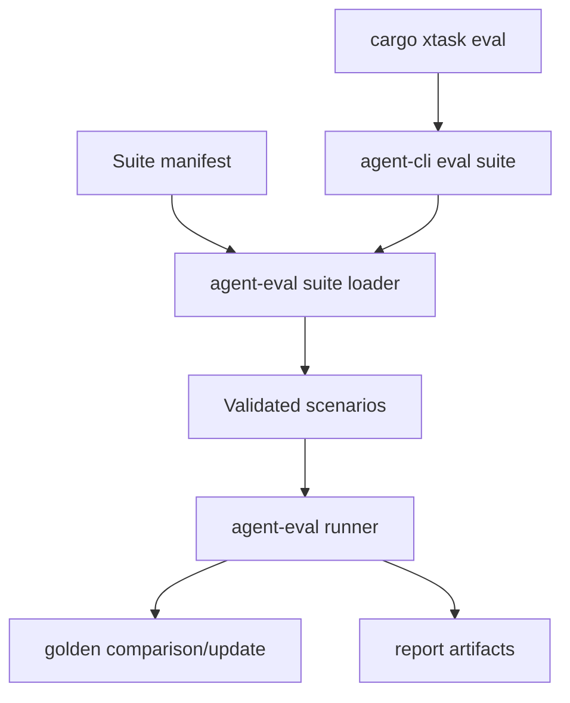

# M28 Evaluation Corpus and Quality Gates Spec

## Purpose

Turn individual evaluation scenarios into managed scenario suites, checked-in fixture corpora, golden update workflows, and CI quality gates that can scale with the runtime.

## Product Context

M27 introduced scenario manifests, a runner, golden comparison, CLI commands, and artifacts. M28 makes those pieces usable as a durable regression system: teams can organize suites, run stable subsets, update goldens deliberately, and fail CI on runtime regressions with reproducible diagnostics.

## Scope

This milestone delivers:

- versioned scenario suite manifests that reference many scenario manifests safely
- a small built-in regression corpus based on existing replay/evidence fixtures
- golden update workflow contracts and safe update output
- CLI commands for suite list, validate, run, and update-golden flows
- `xtask` quality gate integration for local and CI use

Owned by other milestones:

- single-scenario manifest, runner, comparison, and artifact writer: M27
- hosted CI provider configuration and dashboards: future milestones

## Architecture

`agent-eval` continues to own evaluation contracts and runtime-adjacent logic. Scenario suites live beside scenario files and resolve paths relative to a suite root. CLI and `xtask` invoke `agent-eval` and render typed reports/artifacts only.



## File Layout

```text
crates/
  agent-eval/
    src/suite.rs
    tests/suite.rs
  agent-cli/
    tests/eval_suite_commands.rs
xtask/
  src/lib.rs
  src/main.rs
docs/
  eval/
  specs/M28-*.spec.md
  plans/M28-*.plan.md
```

## Public Contracts

```rust
pub struct EvalSuiteManifest {
    pub schema_version: u32,
    pub id: String,
    pub name: String,
    pub scenarios: Vec<EvalSuiteScenarioRef>,
}

pub struct EvalSuiteRunReport {
    pub suite_id: String,
    pub report: EvalRunReport,
}
```

## State and Failure Handling

- suite validation happens before scenarios run
- unsafe paths, duplicate IDs, and missing scenario files fail validation
- suite runs preserve per-scenario reports even when some scenarios fail
- golden updates are explicit and never happen during plain run mode
- CI gates exit non-zero on failed or invalid scenarios

## Security and Privacy

- suite and scenario manifests are untrusted input
- suite paths cannot traverse outside declared roots
- artifacts and golden mismatch diagnostics use existing redaction paths
- golden update output writes normalized reports, not raw secrets

## Testing Strategy

- suite manifest serde and validation tests
- built-in corpus smoke tests using existing fixtures
- golden update tests for explicit update mode
- CLI suite command tests for text/JSON output and exit codes
- `xtask` plan tests for CI command shape

## Acceptance Criteria

- M28 slice specs and plans exist for suite manifests, built-in corpus, golden updates, CLI suite commands, and `xtask` gates.
- Each completed slice ships source, tests, docs status updates, and a git commit.
- `cargo xtask check` passes before M28 is marked complete.

## Completion Signal

M28 is complete when scenario suites can be validated, run, compared, updated, and invoked from a CI-friendly command, with artifacts and milestone status updated.
