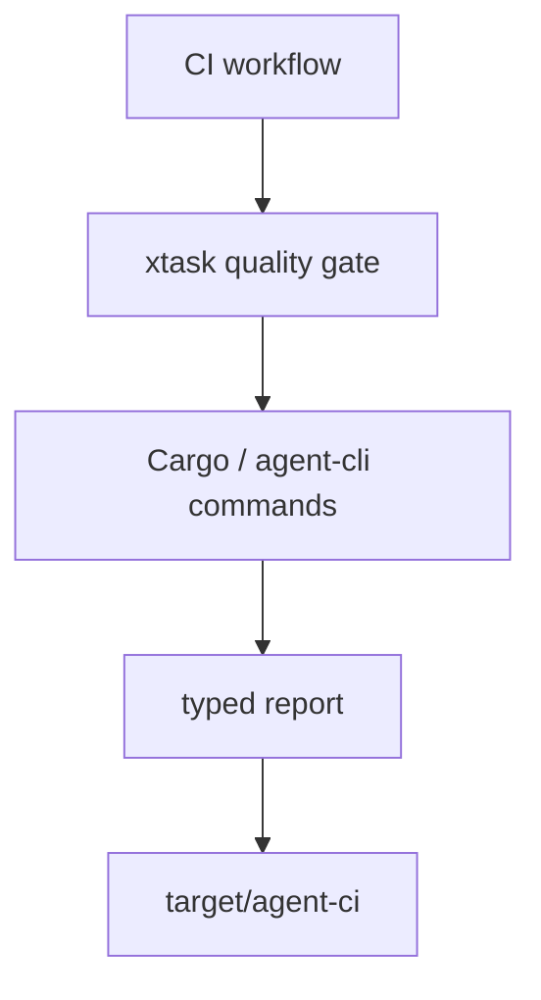

# M29-00 CI Quality Technical Design Spec

## Purpose

Define the architecture for shared quality gates before implementation begins.

## Product Context

M28 produced evaluation suites and `cargo xtask eval`. M29 combines the workspace checks and evaluation gate into one evidence-producing workflow for local development, CI, and release review.

## Scope

This spec delivers:

- ownership boundaries for quality gate execution
- report schema and artifact paths
- command ordering and failure propagation rules
- hosted CI workflow boundary
- privacy requirements for evidence artifacts

Owned by other specs:

- concrete report structs: M29-01
- command runner: M29-02
- workflow YAML: M29-03
- artifact retention: M29-04
- final docs and status: M29-05

## Architecture

`xtask` remains the quality orchestration crate. It plans commands, runs them, records status, and writes evidence. Runtime and CLI crates expose commands but do not know about CI.



## File Layout

```text
xtask/
  src/lib.rs
  src/main.rs
docs/
  specs/M29-*.spec.md
  plans/M29-*.plan.md
```

## Public Contracts

```rust
pub const QUALITY_GATE_REPORT_SCHEMA_VERSION: u32 = 1;
```

## State and Failure Handling

- planned steps are deterministic
- each attempted step records start/end status
- command failure stops the default gate after writing a report
- missing artifact directories are created before report writes

## Security and Privacy

- reports exclude stdout and stderr by default
- report messages are bounded and redacted
- environment values are not serialized
- CI workflow does not add secret-bearing variables

## Testing Strategy

- report shape tests
- command plan tests
- failure status aggregation tests
- workflow fixture validation

## Acceptance Criteria

- M29 is decomposed into slice specs and plans.
- milestone index points to M29-01 as active work.

## Completion Signal

M29-00 is complete when implementation can begin from M29-01 without open design gaps.
