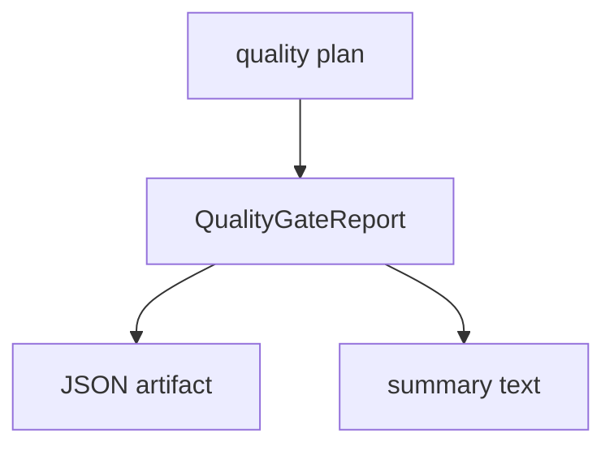

# M29-01 Quality Gate Report Contracts Spec

## Purpose

Add typed quality gate report contracts so CI and release review can consume one stable evidence format.

## Product Context

`cargo xtask check` and `cargo xtask eval` already run useful gates, but their results are ephemeral terminal output. M29-01 introduces durable report contracts before adding command execution.

## Scope

This spec delivers:

- `QualityGateReport`
- `QualityGateStepReport`
- `QualityGateStatus`
- JSON serialization and text summary rendering

Owned by other specs:

- command execution and report writing: M29-02
- hosted CI workflow: M29-03

## Architecture

Contracts live in `xtask` because quality gates are workspace orchestration, not runtime behavior.



## File Layout

```text
xtask/
  src/lib.rs
  tests/quality_gate.rs
```

## Public Contracts

```rust
pub struct QualityGateReport {
    pub schema_version: u32,
    pub run_id: String,
    pub status: QualityGateStatus,
    pub steps: Vec<QualityGateStepReport>,
}
```

## State and Failure Handling

- empty reports are invalid for writer paths but can be constructed in tests
- report status is `Failed` if any attempted step fails
- skipped steps remain explicit when a previous failure stops execution

## Security and Privacy

- command args are stored; raw logs and environment values are not
- messages are bounded and redacted before serialization

## Testing Strategy

- serde shape test
- aggregate status test
- text summary test
- redaction test

## Acceptance Criteria

- focused `xtask` quality gate contract tests pass.

## Completion Signal

M29-01 is complete when report contracts are public, serializable, and tested.
