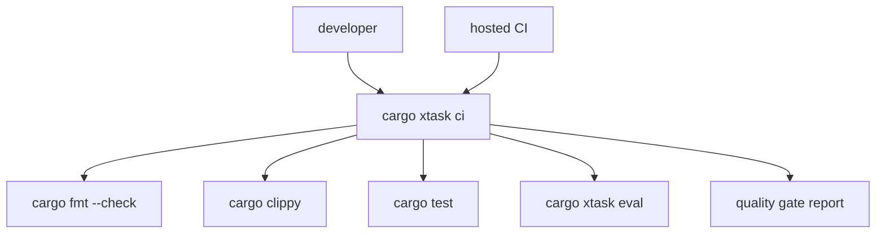

# M29 CI Quality Evidence and Release Gates Spec

## Purpose

Turn local checks, evaluation suites, and release smoke commands into one auditable quality gate that produces durable evidence for local development and hosted CI.

## Product Context

M28 made evaluation suites runnable from CLI and `xtask`. The next production gap is a stable quality evidence layer: CI should run the same gates as developers, preserve machine-readable reports, and fail with clear diagnostics without each workflow reinventing command glue.

## Scope

This milestone delivers:

- typed quality gate report contracts in `xtask`
- `cargo xtask ci` command planning and execution
- default CI command set covering fmt, clippy, workspace tests, and eval corpus
- repository CI workflow that invokes the shared gate
- redacted JSON and text artifacts suitable for CI upload and release review

Owned by other milestones:

- evaluation suite semantics and corpus files: M28
- package artifact construction: M25
- external dashboard publishing and hosted release signing: later milestones

## Architecture

`xtask` owns quality-gate orchestration and evidence reports. It invokes existing Cargo and CLI commands; it does not parse eval suites, test output, or runtime events. Hosted CI workflows call `cargo xtask ci` and upload the generated artifacts.



## File Layout

```text
xtask/
  src/lib.rs
  src/main.rs
  tests/quality_gate.rs
.github/
  workflows/ci.yml
docs/
  specs/M29-*.spec.md
  plans/M29-*.plan.md
```

## Public Contracts

```rust
pub struct QualityGateReport {
    pub schema_version: u32,
    pub run_id: String,
    pub status: QualityGateStatus,
    pub steps: Vec<QualityGateStepReport>,
}

pub enum QualityGateStatus {
    Passed,
    Failed,
}
```

## State and Failure Handling

- steps execute in deterministic order
- the report records every attempted step
- a failing step stops later side-effecting gates unless explicitly marked `always_run`
- command exit codes propagate to the `xtask ci` process
- reports are newline-terminated JSON and text summaries

## Security and Privacy

- reports store command names, exit codes, durations, and artifact paths, not raw command logs
- paths are workspace-relative where possible
- quality artifacts do not contain secrets or environment dumps
- hosted CI configuration uses default repository tokens only

## Testing Strategy

- command planning tests for default CI gates
- report serialization and status aggregation tests
- failure propagation tests with fixture commands
- workflow text validation for expected `cargo xtask ci` invocation
- final `cargo xtask check` plus `cargo xtask eval`

## Acceptance Criteria

- M29 milestone-level and slice-level docs exist.
- `cargo xtask ci` produces `target/ruse-ci/quality-gate-report.json` and summary text.
- hosted CI invokes the shared gate.
- final workspace checks pass before M29 is marked complete.

## Completion Signal

M29 is complete when quality gates can be run locally and in CI through one `xtask` command, with typed evidence artifacts and milestone status updated.
