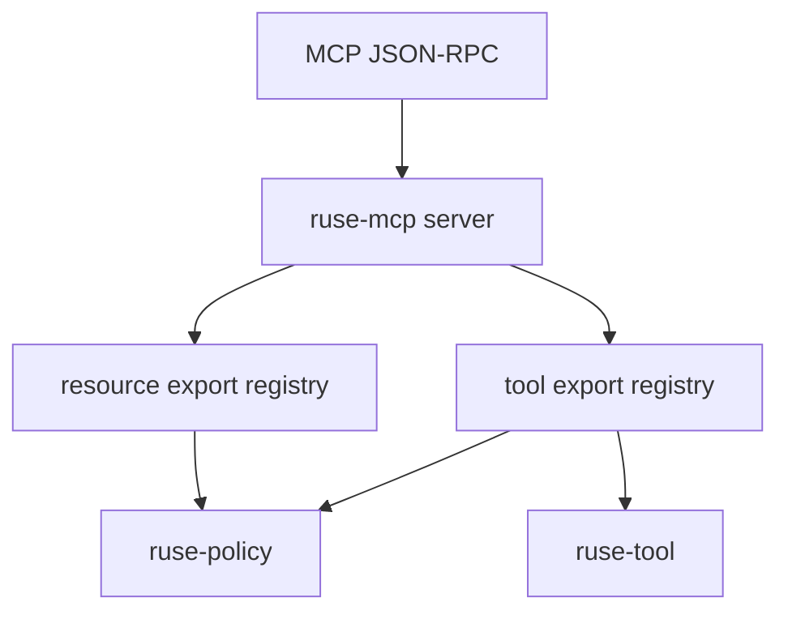

# M30-00 MCP Server Technical Design Spec

## Purpose

Define the architecture for local MCP server export before implementation begins.

## Product Context

MCP client and gateway support lets agent consume external servers. M30 adds server mode so external MCP clients can inspect selected local capabilities without receiving unrestricted access to the runtime.

## Scope

This spec delivers:

- server protocol ownership boundaries
- export registry model for tools and resources
- JSON-RPC frame handling rules
- policy, audit, and privacy requirements
- verification gates for M30 slices

Owned by other specs:

- concrete server structs: M30-01
- executable tool export: M30-02
- resource export: M30-03
- stdio fixture server: M30-04
- CLI/docs: M30-05

## Architecture

`ruse-mcp` is the only crate that understands MCP server wire contracts. It depends on `ruse-tool`, `ruse-policy`, and `ruse-types` for local export metadata and policy integration. Runtime orchestration remains in `ruse-core`.



## File Layout

```text
crates/ruse-mcp/src/
  server.rs
  server_tool.rs
  server_resource.rs
crates/ruse-mcp/tests/
  mcp_server_contracts.rs
  mcp_server_tool_export.rs
  mcp_server_resource_export.rs
  mcp_server_stdio.rs
```

## Public Contracts

```rust
pub struct McpServerState {
    pub info: McpServerInfo,
    pub capabilities: McpServerCapabilities,
}
```

## State and Failure Handling

- server starts uninitialized
- `initialize` records negotiated protocol metadata
- list methods are read-only and deterministic
- call/read methods evaluate policy before access
- unsupported methods and invalid params return typed errors

## Security and Privacy

- exports are explicit and disabled by default
- wire diagnostics are redacted and bounded
- resource contents must opt into export
- tool calls keep local policy and audit paths

## Testing Strategy

- focused contract tests per slice
- malformed frame tests
- denial tests proving no side effects
- final `cargo xtask ci`

## Acceptance Criteria

- M30 is decomposed into implementation slices.
- crate boundaries are clear before code begins.

## Completion Signal

M30-00 is complete when design and slice plans exist and M30-01 can begin without open ownership questions.
