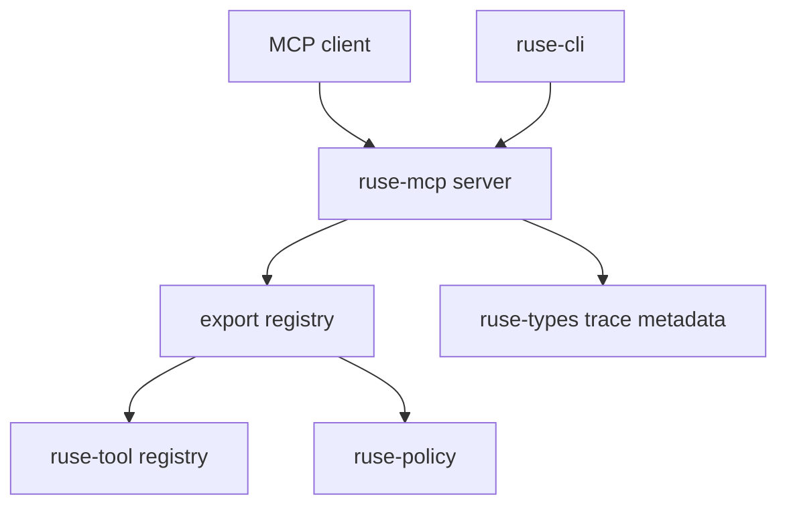

# M30 MCP Server Export Spec

## Purpose

Add MCP server mode so agent can expose selected local tools and resources to trusted MCP clients through typed, policy-aware contracts.

## Product Context

The PRD requires the MCP layer to support both client/gateway use and server mode. M07 and M22 made remote MCP servers usable as local tools. M30 completes the opposite direction: selected local agent capabilities can be exported through MCP without bypassing local policy, audit, redaction, or runtime ownership boundaries.

## Scope

This milestone delivers:

- MCP server protocol contracts in `ruse-mcp`
- selected local tool export through a server registry
- selected local resource export through safe descriptors
- deterministic JSON-RPC/stdio fixture handling for tests
- CLI and trace-facing surface for server readiness

Owned by other milestones:

- remote MCP client and gateway: M07 and M22
- full hosted marketplace discovery: later milestones
- network listener hardening and authentication beyond local stdio: later milestones

## Architecture

`ruse-mcp` owns MCP server contracts and protocol normalization. `ruse-tool` remains the source of executable tool definitions. `ruse-policy` remains the permission boundary. `ruse-core`, `ruse-cli`, TUI, and Desktop consume server state; they do not own protocol semantics.



## File Layout

```text
crates/
  ruse-mcp/
    src/server.rs
    src/server_tool.rs
    src/server_resource.rs
    src/server_status.rs
    src/server_stdio.rs
    tests/mcp_server_*.rs
  ruse-cli/
    tests/mcp_server_commands.rs
docs/
  specs/M30-*.spec.md
  plans/M30-*.plan.md
```

## Public Contracts

```rust
pub struct McpServerInfo {
    pub name: String,
    pub version: String,
    pub protocol_version: String,
}

pub struct McpServerCapabilities {
    pub tools: bool,
    pub resources: bool,
    pub prompts: bool,
}

pub struct McpServerStatusSummary {
    pub available: bool,
    pub exported_tool_count: usize,
    pub exported_resource_count: usize,
}
```

## State and Failure Handling

- server initialization is explicit and returns capability metadata
- unknown methods return typed MCP errors
- disabled exports are omitted from list responses
- denied tool/resource access returns an error without executing local side effects
- malformed JSON-RPC frames are rejected without mutating server state

## Security and Privacy

- local server mode is deny-by-default until exports are explicitly selected
- tool inputs, resource contents, and diagnostics are bounded and redacted
- secrets are never exported as resource contents or protocol metadata
- every side-effecting tool call still maps to local policy and audit contracts

## Testing Strategy

- protocol serde tests for initialize, tools/list, tools/call, resources/list, and resources/read
- export registry tests for allow/deny/disabled behavior
- stdio JSON-RPC fixture tests for success and malformed frames
- CLI tests for server command shape and safe diagnostics

## Acceptance Criteria

- M30 milestone and slice specs/plans exist.
- `ruse-mcp` exposes typed MCP server contracts.
- selected local tools/resources can be listed through deterministic server fixtures.
- policy-denied calls do not execute local tools.
- focused M30 tests and workspace quality gates pass before M30 is marked complete.

## Completion Signal

M30 is complete when local MCP server mode has typed contracts, deterministic fixture handling, policy-aware exports, CLI visibility, docs, and verified tests.
