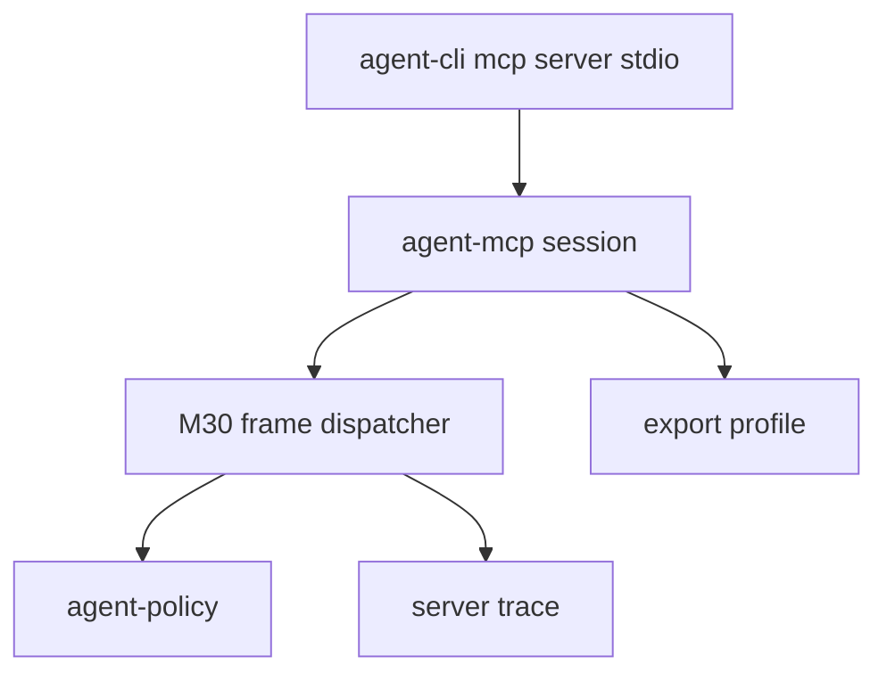

# M31-00 MCP Stdio Server Technical Design Spec

## Purpose

Define the architecture for a production-shaped local MCP stdio server runtime before implementation begins.

## Product Context

M30 added protocol contracts and deterministic frame handling. M31 must preserve those contracts while adding long-running session behavior, process IO boundaries, and trace-safe operations.

## Scope

This spec delivers:

- session lifecycle and state ownership
- process IO boundary between CLI and `agent-mcp`
- export profile bootstrap design
- trace/audit and privacy rules
- verification gates for M31 slices

Owned by other specs:

- session runtime: M31-01
- export profile bootstrap: M31-02
- CLI command: M31-03
- trace/audit summaries: M31-04
- hardening docs: M31-05

## Architecture

`agent-mcp` owns session state and protocol decisions. `agent-cli` converts stdin lines into session frames and writes session responses to stdout. CLI stderr may contain redacted lifecycle diagnostics only.



## File Layout

```text
crates/agent-mcp/src/
  server_session.rs
  server_profile.rs
  server_trace.rs
crates/agent-cli/tests/
  mcp_server_stdio_command.rs
```

## Public Contracts

```rust
pub enum McpServerSessionStatus {
    Created,
    Initialized,
    Closed,
}
```

## State and Failure Handling

- session accepts frames until EOF, cancellation, fatal IO error, or configured frame limit
- malformed frames produce protocol errors and keep the session usable
- frame size limits are enforced before JSON parsing
- shutdown returns a deterministic summary

## Security and Privacy

- default profile exports nothing
- no raw resource contents appear in trace summaries
- stderr diagnostics are bounded and redacted
- stdout contains only protocol frames

## Testing Strategy

- session state transition tests
- malformed frame recovery tests
- profile default-deny tests
- CLI subprocess smoke tests
- final `cargo xtask ci`

## Acceptance Criteria

- ownership and dependency direction are documented.
- each M31 implementation slice has a spec and plan.

## Completion Signal

M31-00 is complete when the technical design and all slice plans exist and M31-01 can begin without open ownership questions.
