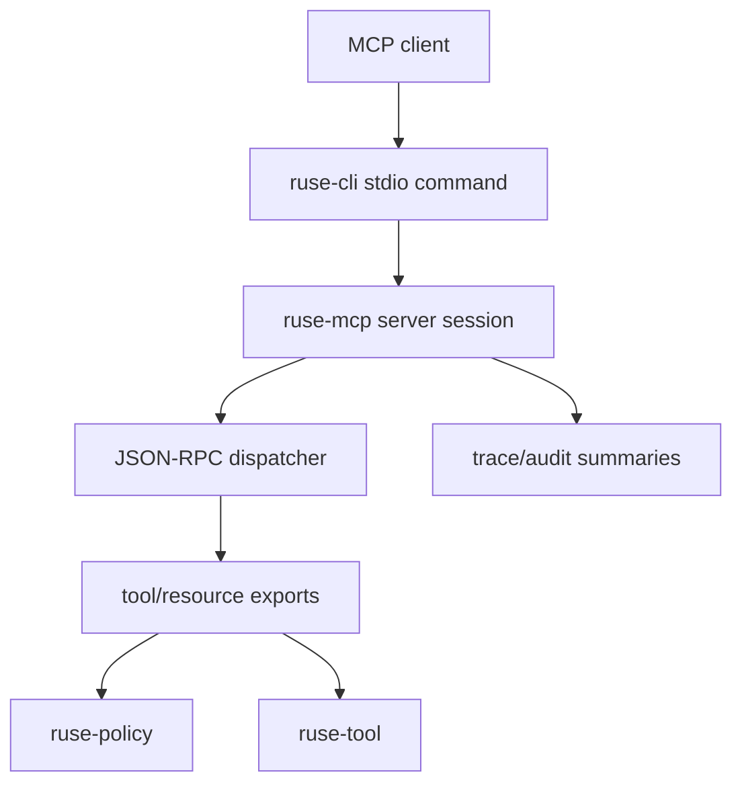

# M31 MCP Stdio Server Runtime Spec

## Purpose

Turn the M30 MCP server contracts and fixtures into a runnable, policy-aware stdio server runtime that can serve trusted local MCP clients without bypassing local export, policy, trace, or privacy rules.

## Product Context

M30 proved MCP server protocol contracts, export registries, deterministic frame handling, and CLI readiness visibility. M31 closes the next product gap: `agent` should be able to run as a local MCP stdio server process, read JSON-RPC frames from stdin, write line-framed responses to stdout, and expose only configured safe capabilities.

## Scope

This milestone delivers:

- durable stdio server session contracts in `ruse-mcp`
- bootstrap export profile for explicitly selected tools/resources
- CLI command shape for `ruse-cli mcp server stdio`
- server trace/audit summaries for initialize/list/call/read frames
- lifecycle hardening, docs, and final quality gate

Owned by other milestones:

- network listener authentication: later milestone
- marketplace/provider-backed export discovery: later milestone
- Desktop server lifecycle management: later milestone

## Architecture

`ruse-mcp` owns protocol/session/runtime behavior. `ruse-cli` owns process IO, argument parsing, and rendering only. `ruse-policy` remains the permission boundary, and `ruse-tool` remains the executable tool registry. Durable audit and trace summaries stay typed and redacted.



## File Layout

```text
crates/
  ruse-mcp/
    src/server_session.rs
    src/server_profile.rs
    src/server_trace.rs
    tests/mcp_server_session.rs
    tests/mcp_server_profile.rs
    tests/mcp_server_trace.rs
  ruse-cli/
    tests/mcp_server_stdio_command.rs
docs/
  specs/M31-*.spec.md
  plans/M31-*.plan.md
```

## Public Contracts

```rust
pub struct McpServerSessionConfig {
    pub max_frame_bytes: usize,
    pub max_frames: Option<u64>,
}

pub struct McpServerExportProfile {
    pub tools: Vec<String>,
    pub resources: Vec<String>,
}
```

## State and Failure Handling

- session starts in `Created`, becomes `Initialized` after `initialize`, and becomes `Closed` on EOF, cancellation, or frame limit
- malformed frames return JSON-RPC errors and do not poison the session
- policy-denied calls/read attempts return bounded errors and do not execute local side effects
- stdio loop drains one line at a time and never writes raw tool/resource secrets

## Security and Privacy

- default export profile exposes no tools/resources
- all exports are explicit and status-visible before serving
- stderr diagnostics are bounded and redacted
- stdout remains protocol-only JSON-RPC frames
- server trace summaries include method, status, ids, export names, and policy outcome, not raw resource contents

## Testing Strategy

- deterministic in-memory session tests
- export profile validation tests
- CLI stdio subprocess smoke tests
- trace/audit redaction tests
- final `cargo xtask ci`

## Acceptance Criteria

- `ruse-cli mcp server stdio` can initialize and list safe default exports over stdin/stdout.
- server sessions preserve state across malformed frames.
- all tool/resource access still uses M30 policy-aware export registries.
- M31 focused tests and workspace quality gate pass.

## Completion Signal

M31 is complete when a local MCP client can communicate with the CLI stdio server command through deterministic JSON-RPC frames, trace summaries remain redacted, docs are updated, and final quality gates pass.
