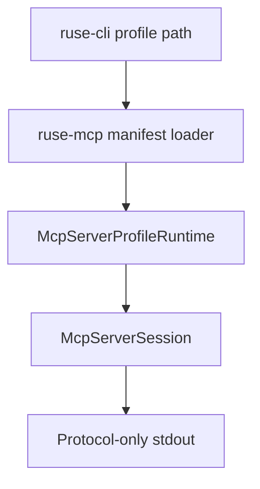

# M32 MCP Export Profile Runtime Spec

## Purpose

Make the MCP stdio server useful beyond the default empty profile by adding typed export manifests, deterministic profile loading, and CLI wiring for explicit tool/resource exports.

## Product Context

M30 proved policy-aware MCP server exports as fixtures. M31 turned the server into a runnable stdio process, but intentionally bootstrapped an empty default profile. M32 closes that gap by letting users start a local MCP server from an auditable export profile while preserving default-deny behavior.

## Scope

This spec delivers:

- versioned MCP server export manifest contracts
- validated resource and tool export profile configuration
- runtime profile construction from explicit manifests
- CLI stdio/profile selection surfaces
- redacted diagnostics and final quality evidence

Owned by other specs:

- MCP protocol frame handling: M30 and M31
- general plugin/MCP gateway management: M22
- permission approvals and leases: M19

## Architecture

`ruse-mcp` owns manifest parsing, validation, profile construction, and privacy rules. `ruse-cli` owns path selection and process IO only. The stdio server continues to run through `McpServerSession`.



## File Layout

```text
crates/ruse-mcp/src/server_manifest.rs
crates/ruse-mcp/src/server_profile.rs
crates/ruse-cli/src/command.rs
crates/ruse-mcp/tests/mcp_server_manifest.rs
crates/ruse-cli/tests/mcp_server_profile_command.rs
```

## Public Contracts

```rust
pub const MCP_SERVER_EXPORT_MANIFEST_SCHEMA_VERSION: u32 = 1;

pub struct McpServerExportManifest {
    pub schema_version: u32,
    pub profiles: Vec<McpServerExportProfileConfig>,
}

pub struct McpServerExportProfileConfig {
    pub name: String,
    pub tools: Vec<McpServerToolExportConfig>,
    pub resources: Vec<McpServerResourceExportConfig>,
}
```

## State and Failure Handling

- invalid manifests fail before stdio starts
- duplicate profile names, tool names, and resource URIs are rejected
- unknown profile selection returns a redacted diagnostic
- file/resource loading failures do not partially start a server
- profile summaries remain safe for CLI/Desktop display

## Security and Privacy

- default behavior remains empty/default-deny
- manifests declare exports explicitly
- secret-like profile names, tool names, paths, URIs, and diagnostics are redacted or rejected
- resource contents are never printed in status or trace summaries
- policy checks still happen at tool call/resource read time

## Testing Strategy

- manifest serde and validation tests
- profile selection and duplicate rejection tests
- file resource loading tests
- CLI stdio/profile subprocess tests
- final `cargo xtask ci`

## Acceptance Criteria

- `ruse-cli mcp server stdio --profile path/to/profile.json --profile-name default` starts with explicit exports.
- invalid manifests fail on stderr without protocol stdout.
- default `ruse-cli mcp server stdio` remains an empty export profile.
- final quality gate passes.

## Completion Signal

M32 is complete when explicit MCP export profiles can back the stdio server, diagnostics are redacted, docs are updated, and the CI quality gate passes.
